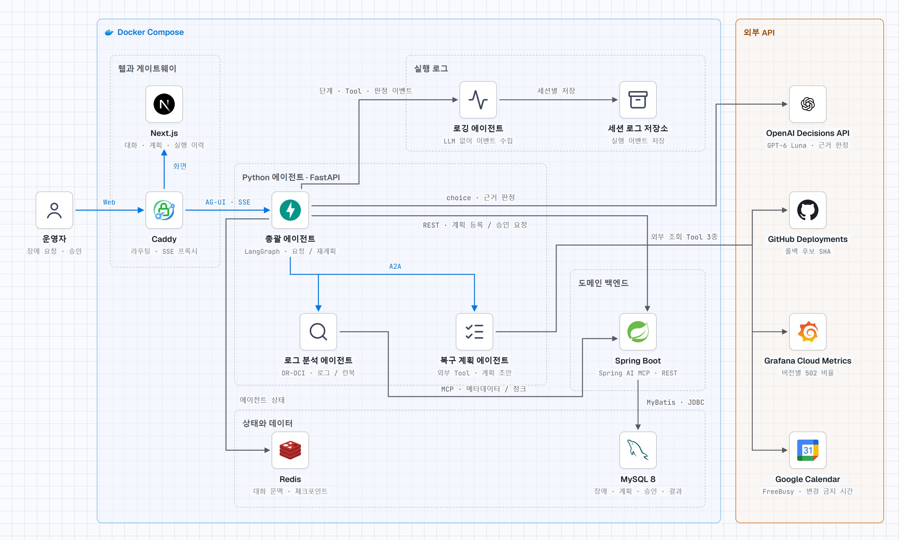
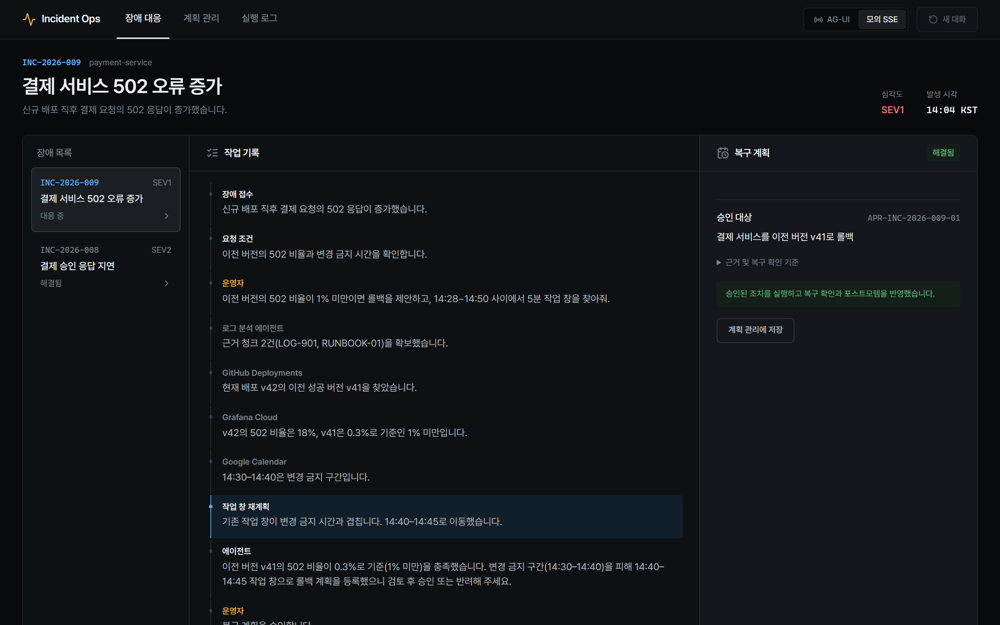
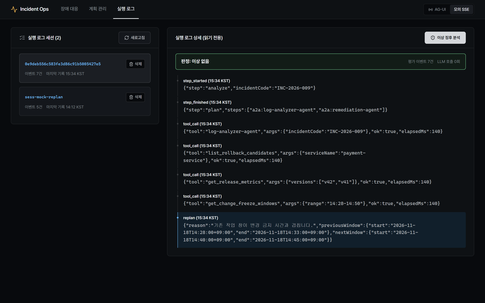

<div align="center">

# Incident Ops Agent

### 근거 있는 장애 분석부터 안전한 롤백 승인·포스트모템까지.

AG-UI · A2A · MCP 3대 표준 프로토콜과 DR-DCI 패턴을 결합한 멀티 에이전트 기반 실시간 장애 대응 워크스페이스입니다.

[주요 화면](#주요-화면-미리보기) · [시스템 구성](#1-시스템-구성) · [실행 방법](#3-실행-방법) · [참고 논문·표준](#5-참고-논문-및-기술-표준) · [요구사항·검증 결과서](docs/10-requirements-and-verification.md)

<p>
  
  
  
  
</p>

<p>
  
  
  
  
  
  
  
</p>

<p>
  
  
  
  
  
  
</p>

<p>
  
  
  
  
  
  
  
  
</p>

<p>
  <a href="#1-시스템-구성">전체 기술 스택 · 아키텍처 보기</a>
</p>


</div>

---

* **표준화된 멀티 에이전트 협업:** 총괄(`supervisor`) 에이전트가 **A2A**(`a2a-sdk`)로 로그 분석(`log_agent`)·복구 계획(`remediation_agent`) 워커에 작업을 위임하고, 각 워커는 **MCP**(`/sse`)를 통해 Spring Boot 장애 원장 및 코퍼스와 통신합니다.
* **컨텍스트 폭발 방지 (DR-DCI):** 수만 줄의 장애 로그와 런북을 한꺼번에 프롬프트에 넣지 않고 `searchCorpusIndex` → `pullCorpusChunk`로 필요한 청크만 동적으로 인출해 추론 정확도를 유지합니다.
* **Human-in-the-Loop 안전 제어 (AG-UI):** 롤백 조치 실행과 포스트모템 확정 직전 **AG-UI** 스트리밍 인터럽트와 Spring 승인 원장(`remediation_approvals`) 검증을 거쳐 운영자의 명시적 승인이 있을 때만 완료 처리됩니다.



---

## 주요 화면 미리보기

### 1. 실시간 장애 대응 워크스페이스 (Spring REST 연동 · 중단 실행 재개)
Spring 백엔드(`INC-2026-001`)의 장애 목록·승인 원장을 서버 BFF로 조회하고, 중단된 승인 건은 **실행 재개**로 이어서 완료할 수 있습니다.


### 2. AG-UI 실시간 스트리밍 · 변경 금지 시간 재계획 · HITL 승인 대기
`HttpAgent`가 `log-analyzer-agent` 및 외부 API Tool 3종(GitHub · Grafana · Google Calendar) 결과를 순서대로 스트리밍하고, 변경 금지 구간(`14:30–14:40`)과 충돌한 초안(`14:28–14:33`)을 `14:40–14:45`로 재계획한 뒤 운영자 승인을 대기합니다.


### 3. 운영자 승인 완료 및 복구 반영 (`RESOLVED`)
운영자 승인 후 복구 조치 실행과 확인 기준·포스트모템 반영이 완료되면 `해결됨` 상태로 전이됩니다.



### 4. 작업 계획 관리 (`F3015` · `F3016` — CRUD 및 시간 겹침 경고)
생성된 복구 계획을 날짜·시각과 함께 저장·수정·삭제할 수 있으며, 같은 날짜에 시간이 겹치는 계획이 있으면 저장을 막지 않고 경고 배너로 안내합니다.


### 5. 실행 로그 조회 및 규칙 기반 이상 징후 분석 (`F3014` · `F3020`)
세션별 실행 이벤트를 수정 불가(읽기 전용) 타임라인으로 조회·삭제하고, 규칙 기반 이상 징후 분석(정상 시 LLM 호출 0회, 이상 건에만 3문장 진단)을 실행할 수 있습니다.



---

## 1. 시스템 구성

| 계층 | 기술 스택 | 포트 | 역할 |
| :--- | :--- | :---: | :--- |
| **Gateway** (`infra/`) | Caddy | `80` | 단일 출처 리버스 프록시 (`/api/ag-ui*`, `/a2a/*`, `/sse*`, `/api/*`, `/`) |
| **Frontend** (`frontend/`) | Next.js 16 (App Router), TypeScript, `@ag-ui/client` | `3000` | 장애 대응 워크스페이스(AG-UI SSE), 계획 관리(CRUD·시간 겹침 경고), 실행 로그·이상 징후 분석, Spring 서버 BFF |
| **Agent** (`agent/`) | Python 3.12, FastAPI, LangGraph, `ag-ui-protocol`, `a2a-sdk`, `mcp`, Redis | `8000`–`8002` | `supervisor(:8000)`, `log_agent(:8001)`, `remediation_agent(:8002)`, 발행-구독 로깅 서브 에이전트(LLM 0회) |
| **Backend** (`backend/`) | Java 21, Spring Boot 3.4.5, MyBatis, Flyway, MySQL 8.0, Spring AI MCP | `8080` | 장애·코퍼스·복구계획·승인·실행·포스트모템 원장 REST API 및 MCP `@Tool` 4종 |

---

## 2. 기능 요약 (필수 · 심화)

### 필수 기능 (`F3001 ~ F3019`)
* **외부 API Tool 3종 (`F3001~F3004`):** GitHub Deployments(`list_rollback_candidates`), Grafana Cloud Prometheus(`get_release_metrics`), Google Calendar FreeBusy(`get_change_freeze_windows`)를 공통 `{ok, data | error}` 계약으로 래핑했습니다. 시계열 누락 등 확인 불가 값은 임의로 채우지 않고 `INSUFFICIENT_DATA`로 구분합니다.
* **LangGraph 5단계 실행·재계획·메모리 (`F3005~F3011`):** `analyze → plan → execute → evaluate → respond` 흐름으로 조건을 추출하고, 변경 금지 구간 충돌이나 근거 부족(`NEED_MORE_EVIDENCE`) 시 기존 Tool 캐시를 재사용해 최대 3회까지 재계획합니다. 일반 인사/사용법 질문은 Tool 호출을 생략하며, Redis 대화 메모리(`memory:{thread_id}`)로 후속 요청의 변경 조건만 갱신합니다.
* **발행-구독 로깅 서브 에이전트 (`F3012~F3014`):** `EventBus`로 단계·Tool·판단 이벤트를 발행하고 `LoggingSubAgent`가 LLM 호출 0회로 Redis(`exec_log:{session_id}`)에 원본 저장합니다. 목록·상세·삭제 API만 제공하며 수정 API는 두지 않습니다.
* **계획 관리 (`F3015~F3016`):** `/api/ag-ui/plans*` API와 프론트엔드 **계획 관리** 탭에서 작업 계획을 저장·조회·수정·삭제할 수 있습니다. 같은 날짜에 시간이 겹치는 계획이 있으면 저장을 막지 않고 경고(`warning`, `overlappingPlans`)로 안내합니다.
* **서비스 구성 및 화면 (`F3017~F3019`):** FastAPI 서버와 Next.js 화면을 분리하고, 실행 단계·Tool 결과·재계획 지점·처리 중 상태·오류 안내·실행 이력·포스트모템을 실시간으로 표시합니다.

### 심화 기능 (`F3020`, `F3021`, `F3023`)
* **로깅 이상 징후 판단 (`F3020`):** `agent/src/common/anomaly.py`와 `GET /api/ag-ui/sessions/{session_id}/anomalies`에서 동일 입력 반복(`REPEATED_IDENTICAL_CALL`), 과다 재계획(`EXCESSIVE_REPLAN`), 미계획 Tool 호출(`UNPLANNED_TOOL_CALL`)을 규칙 기반으로 판정합니다. 근거 이벤트가 없으면 `UNDETERMINED`, 정상이면 `NORMAL`(LLM 0회)을 반환하고, 이상(`ANOMALY`) 판정 건에만 LLM 3문장 원인 진단을 생성합니다.
* **Planner·Worker LLM 분리 비교 (`F3021`):** `agent/src/common/worker_executor.py`의 `SplitWorkerExecutor`는 정상 경로에서 Worker LLM 호출 0회를 유지하고, 수정 가능한 실패(`NO_RESULT`, `INSUFFICIENT_DATA`, `INVALID_INPUT`)에만 고정 인자(`fixed_args`)를 강제 보존한 채 누적 재시도를 수행합니다. 정상 3단계 기준 통합형(4회) 대비 분리형(1회)으로 LLM 호출을 **75% 절감**합니다.
* **교체형 캘린더 어댑터 (`F3023`):** `agent/src/common/calendar_adapter.py`의 `FreezeCalendarAdapter` 인터페이스로 `GoogleCalendarFreezeAdapter`와 로컬 JSON 파일 기반 `LocalFreezeCalendarAdapter`를 환경변수(`CALENDAR_ADAPTER_MODE=google|local`)만으로 교체할 수 있습니다.

---

## 3. 실행 방법

### 3.1 환경변수 설정 (`.env`)
루트 디렉터리에서 `.env.example`을 복사해 `.env`를 작성합니다.

```bash
cp .env.example .env
```

| 환경변수 | 필수 여부 | 발급 및 설정 방법 |
| :--- | :---: | :--- |
| `OPENAI_API_KEY` | 필수(실 LLM) | OpenAI Platform 또는 SSAFY GMS에서 발급 |
| `INTERNAL_SERVICE_TOKEN` | 필수 | 백엔드·에이전트·프론트엔드 서버 간 내부 인증 공유 토큰(임의의 긴 문자열) |
| `GITHUB_TOKEN`, `GITHUB_REPO` | 외부 API | GitHub PAT(`repo_deployment` 또는 `deployments:read`) 및 대상 `owner/repo` |
| `GRAFANA_PROMETHEUS_URL`, `GRAFANA_INSTANCE_ID`, `GRAFANA_METRICS_TOKEN` | 외부 API | Grafana Cloud Prometheus 쿼리 URL, 인스턴스 ID, `metrics:read` 토큰 |
| `GOOGLE_CALENDAR_ID`, `GOOGLE_CALENDAR_TOKEN` | 외부 API | Google Cloud OAuth2 / 서비스 계정 `calendar.readonly` 토큰 및 캘린더 ID |
| `CALENDAR_ADAPTER_MODE`, `LOCAL_FREEZE_CALENDAR_PATH` | 선택(F3023) | `local` 지정 시 Google Calendar 대신 로컬 JSON 파일로 변경 금지 구간 조회 |

> **보안 원칙 (`NF3001`, `NF3002`):** 모든 API 키와 내부 토큰은 `.env` 및 서버 런타임 환경변수에서만 읽으며, 소스코드와 브라우저 응답·실행 로그에 노출하지 않습니다.

### 3.2 Docker Compose 전체 스택 기동
```bash
# 1) 공용 네트워크 및 MySQL·Redis·Caddy 인프라 기동
docker compose -f docker-compose-infra.yaml up -d

# 2) Backend(demo 프로필) · Agent 3종 · Frontend 기동
SPRING_PROFILES_ACTIVE=docker,demo docker compose up -d --build
```
기동 후 `http://localhost`에서 Caddy 단일 출처로 접속합니다.

### 3.3 프론트엔드 단독 실행 (모의 SSE로 전체 화면 확인)
```bash
cd frontend
npm ci
npm run dev -- --port 3100
```
* 모의 SSE 모드 접속: `http://localhost:3100/?mode=mock`
* 로컬 Supervisor(`:8000`) + Spring(`:8080`) 연동 실행:
  ```bash
  SUPERVISOR_URL=http://localhost:8000 \
  BACKEND_INTERNAL_URL=http://localhost:8080 \
  INTERNAL_SERVICE_TOKEN=<공유_내부_토큰> \
  npm run dev -- --port 3100
  ```

### 3.4 자동화 테스트 실행
```bash
# Backend (Java 21 + Maven, 23건)
cd backend && mvn test

# Agent (Python 3.12 + pytest, 35건)
cd agent && .venv/Scripts/pytest tests

# Frontend (Next.js typecheck + build + 통합 테스트 16건)
cd frontend && npm run typecheck && npm run build && npm test
```

---

## 4. 사용한 외부 API 출처 및 이용 조건 (`NF3007`)

| 외부 API | 출처 (공식 문서) | 주요 이용 조건 및 호출 한도 |
| :--- | :--- | :--- |
| **GitHub REST API (Deployments)** | https://docs.github.com/en/rest/deployments | 인증 PAT 기준 시간당 5,000회(`X-RateLimit-Remaining` 감시, 429/403 시 `RATE_LIMITED` 처리). GitHub API Terms 준수 |
| **Grafana Cloud Prometheus API** | https://grafana.com/docs/grafana-cloud/ | Free/Pro 플랜 쿼리 동시성 및 시계열 한도 준수, PromQL 라벨 인젝션 차단 정규식 적용 |
| **Google Calendar API (FreeBusy)** | https://developers.google.com/workspace/calendar/api/guides/overview | 프로젝트 기본 일일 쿼터(1,000,000 req/day) 및 분당 사용자 한도 준수, 읽기 전용 스코프(`calendar.readonly`) 최소 권한 사용 |
| **OpenAI API / Decisions API** | https://platform.openai.com/docs | API 키 환경변수 관리, 장애 로그 외 민감 시크릿 마스킹 후 전달, 모델별 RPM/TPM 한도 준수 |

---

## 5. 참고 논문 및 기술 표준

### 적용 기술별 참고 논문

| 적용 영역 | 참고 논문 | 프로젝트 반영 내용 |
| :--- | :--- | :--- |
| **DR-DCI 동적 코퍼스 인출** | Yi Lu et al., *Dr-DCI: Scaling Direct Corpus Interaction via Dynamic Workspace Expansion* ([arXiv:2606.14885](https://arxiv.org/abs/2606.14885)) | `log_agent`가 Spring MCP `searchCorpusIndex` → `pullCorpusChunk`로 필요한 로그·런북 청크만 동적 인출(`DR_DCI_MAX_PULL_STEPS`, `DR_DCI_MAX_CHUNK_CHARS`) |
| **컨텍스트 폭발·열화 방지** | Nelson F. Liu et al., *Lost in the Middle: How Language Models Use Long Contexts*, TACL 2024 ([arXiv:2307.03172](https://arxiv.org/abs/2307.03172)) | 전체 로그 일괄 프롬프트 적재를 피하고 핵심 근거 청크 ID·요약 중심으로 추론 컨텍스트를 유지 |
| **Planner · Worker 분리 (`F3021`)** | Binfeng Xu et al., *ReWOO: Decoupling Reasoning from Observations for Efficient Augmented Language Models* ([arXiv:2305.18323](https://arxiv.org/abs/2305.18323)) | `SplitWorkerExecutor`로 계획 수립과 도구 실행을 분리해 정상 경로 Worker LLM 호출 0회·총 LLM 호출 75% 절감 및 고정 인자(`fixed_args`) 불변 보존 |
| **추론·도구 호출·재계획 루프** | Shunyu Yao et al., *ReAct: Synergizing Reasoning and Acting in Language Models*, ICLR 2023 ([arXiv:2210.03629](https://arxiv.org/abs/2210.03629)) | LangGraph 5단계(`analyze → plan → execute → evaluate → respond`)에서 외부 Tool 관측 결과와 제약 조건을 비교하고 미충족 시 재계획 |

### 프로토콜 · 판정 기술 표준

| 프로토콜 / API | 공식 명세 | 프로젝트 적용 구간 |
| :--- | :--- | :--- |
| **AG-UI** | [Agent-User Interaction Protocol](https://docs.ag-ui.com) | Frontend(`@ag-ui/client` `HttpAgent`) ↔ `supervisor:8000` 실시간 SSE 스트리밍·상태 동기화·HITL 승인 재개 |
| **A2A** | [Agent2Agent Protocol](https://a2a-protocol.org) | `supervisor:8000` ↔ `log_agent:8001` · `remediation_agent:8002` AgentCard 및 JSON-RPC 2.0 작업 위임 |
| **MCP** | [Model Context Protocol](https://modelcontextprotocol.io) | Agent ↔ Spring Boot(`:8080/sse`) 도메인 코퍼스 인출·승인 검증 기반 완료 처리 |
| **Decisions API** | [OpenAI Decisions API Guide](https://developers.openai.com/api/docs/guides/decisions) | `remediation_agent`의 근거 기반 3분기 판정(`SUPPORTED` / `NEED_MORE_EVIDENCE` / `CONTRADICTED`) |

---

## 6. 산출물 및 상세 문서 목록

* **요구사항 정의서 · 검증 결과서:** [docs/10-requirements-and-verification.md](docs/10-requirements-and-verification.md)
* **아키텍처 · DB 스키마 · ERD:** [docs/01-architecture-and-db.md](docs/01-architecture-and-db.md) · [docs/06-stack-diagram.md](docs/06-stack-diagram.md)
* **백엔드 REST & MCP 명세:** [docs/02-backend-api-and-mcp-spec.md](docs/02-backend-api-and-mcp-spec.md)
* **도메인 플래너 & 근거 판정 설계:** [docs/04-domain-planner-and-decisions.md](docs/04-domain-planner-and-decisions.md)
* **외부 API Tool 정의서:** [docs/05-external-api-tools.md](docs/05-external-api-tools.md)
* **Agent · Frontend 구현 계획 및 API 계약:** [docs/07-agent-phase-plan.md](docs/07-agent-phase-plan.md) · [docs/08-frontend-phase-plan.md](docs/08-frontend-phase-plan.md) · [docs/09-frontend-api-spec.md](docs/09-frontend-api-spec.md)
* **대표 실행 로그 샘플:** [정상 실행 샘플](agent/samples/session-log-normal.json) · [재계획 실행 샘플](agent/samples/session-log-replan.json)
