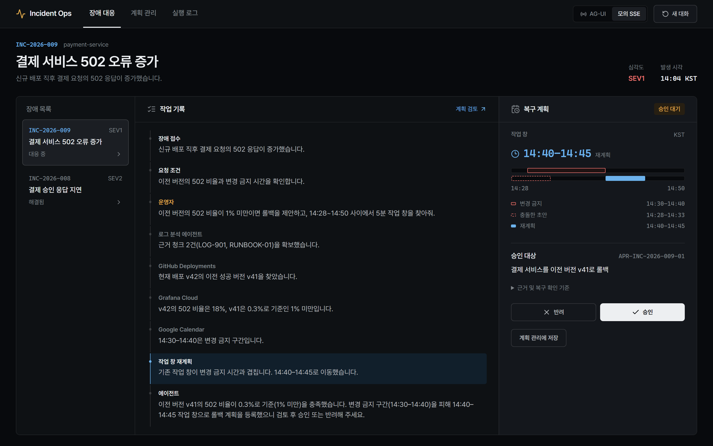
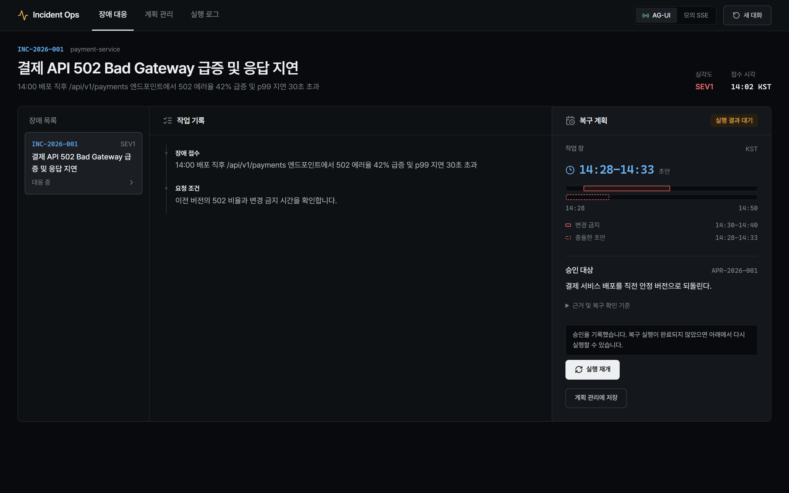
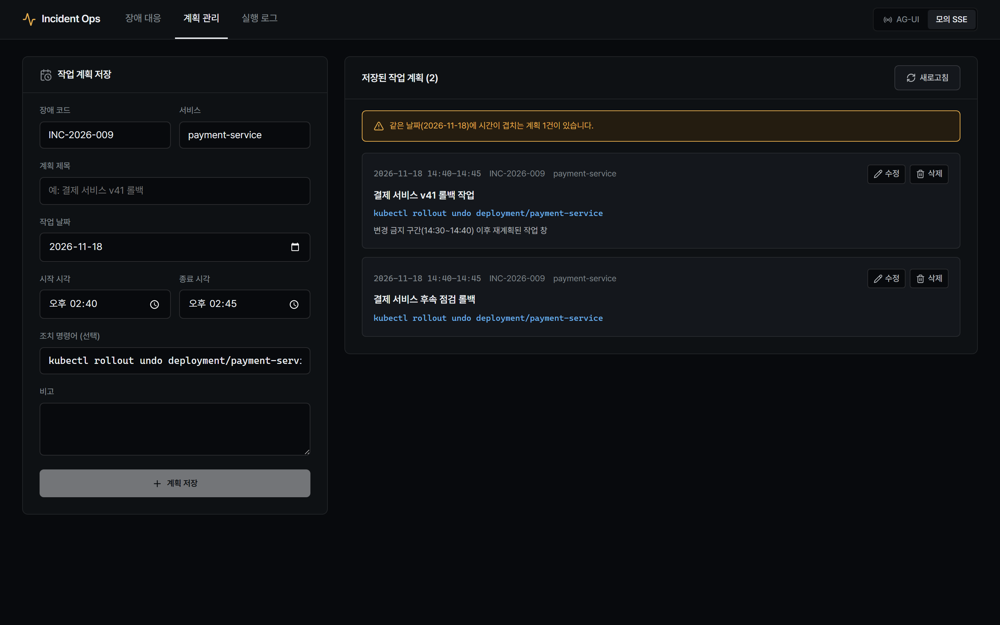

<div align="center">

# Incident Ops Agent

### 근거 있는 장애 분석부터 안전한 롤백 승인·포스트모템까지.

AI 에이전트가 운영 환경에 손댈 때 필요한 **근거 · 승인 · 감사** 를 갖춘 멀티 에이전트 장애 대응 워크스페이스입니다.
AG-UI · A2A · MCP 3대 표준 프로토콜과 DR-DCI 패턴을 결합했습니다.

[주요 화면](#주요-화면-미리보기) · [시스템 구성](#1-시스템-구성) · [핵심 기능](#2-핵심-기능) · [현재 범위와 로드맵](#3-현재-범위와-로드맵) · [실행 방법](#4-실행-방법) · [참고 논문·표준](#6-참고-논문-및-기술-표준) · [검증 결과서](docs/10-verification.md)

<p>
  
  
  
  
</p>

<p>
  
  
  
  
  
  
  
</p>

<p>
  
  
  
  
  
  
</p>

<p>
  
  
  
  
  
  
  
  
</p>



</div>

---

## 왜 만들었나요?

운영 환경의 롤백은 틀리면 비용이 큰 조치입니다. 에이전트가 로그를 읽고 계획을 세우는 것까지는 자동화할 수 있어도, **근거 없이 제안하거나 승인 없이 실행해서는 안 됩니다.** 이 프로젝트는 "AI는 제안하고, 계산은 결정적 코드가, 최종 결정은 사람이 한다"는 원칙을 장애 대응 도메인에 적용한 구현입니다.

* **표준화된 멀티 에이전트 협업:** 총괄(`supervisor`) 에이전트가 **A2A**(`a2a-sdk`)로 로그 분석(`log_agent`)·복구 계획(`remediation_agent`) 워커에 작업을 위임하고, 각 워커는 **MCP**(`/sse`)를 통해 Spring Boot 장애 원장 및 코퍼스와 통신합니다.
* **컨텍스트 폭발 방지 (DR-DCI):** 수만 줄의 장애 로그와 런북을 한꺼번에 프롬프트에 넣지 않고 `searchCorpusIndex` → `pullCorpusChunk`로 필요한 청크만 동적으로 인출해 추론 정확도를 유지합니다.
* **Human-in-the-Loop 안전 제어 (AG-UI):** 롤백 조치 실행과 포스트모템 확정 직전 **AG-UI** 스트리밍 인터럽트와 Spring 승인 원장(`remediation_approvals`) 검증을 거쳐 운영자의 명시적 승인이 있을 때만 완료 처리됩니다.


---

## 주요 화면 미리보기

### 1. 실시간 장애 대응 워크스페이스 (Spring REST 연동 · 중단 실행 재개)
Spring 백엔드(`INC-2026-001`)의 장애 목록·승인 원장을 서버 BFF로 조회하고, 중단된 승인 건은 **실행 재개**로 이어서 완료할 수 있습니다.



### 2. AG-UI 실시간 스트리밍 · 변경 금지 시간 재계획 · 승인 대기
`HttpAgent`가 `log-analyzer-agent` 및 외부 API Tool 3종(GitHub · Grafana · Google Calendar) 결과를 순서대로 스트리밍하고, 변경 금지 구간(`14:30–14:40`)과 충돌한 초안(`14:28–14:33`)을 `14:40–14:45`로 재계획한 뒤 운영자 승인을 대기합니다.


### 3. 운영자 승인 완료 및 복구 반영 (`RESOLVED`)
운영자 승인 후 복구 조치 실행과 확인 기준·포스트모템 반영이 완료되면 `해결됨` 상태로 전이됩니다.


### 4. 작업 계획 관리 (CRUD 및 시간 겹침 경고)
생성된 복구 계획을 날짜·시각과 함께 저장·수정·삭제할 수 있으며, 같은 날짜에 시간이 겹치는 계획이 있으면 저장을 막지 않고 경고 배너로 안내합니다.



### 5. 실행 로그 조회 및 규칙 기반 이상 징후 분석
세션별 실행 이벤트를 수정 불가(읽기 전용) 타임라인으로 조회·삭제하고, 규칙 기반 이상 징후 분석(정상 시 LLM 호출 0회, 이상 건에만 3문장 진단)을 실행할 수 있습니다.


---

## 1. 시스템 구성

| 계층 | 기술 스택 | 포트 | 역할 |
| :--- | :--- | :---: | :--- |
| **Gateway** (`infra/`) | Caddy | `80` | 단일 출처 리버스 프록시 (`/api/ag-ui*`, `/a2a/*`, `/sse*`, `/api/*`, `/`) |
| **Frontend** (`frontend/`) | Next.js 16 (App Router), TypeScript, `@ag-ui/client` | `3000` | 장애 대응 워크스페이스(AG-UI SSE), 계획 관리(CRUD·시간 겹침 경고), 실행 로그·이상 징후 분석, Spring 서버 BFF |
| **Agent** (`agent/`) | Python 3.12, FastAPI, LangGraph, `ag-ui-protocol`, `a2a-sdk`, `mcp`, Redis | `8000`–`8002` | `supervisor(:8000)`, `log_agent(:8001)`, `remediation_agent(:8002)`, 발행-구독 로깅 서브 에이전트(LLM 0회) |
| **Backend** (`backend/`) | Java 21, Spring Boot 3.4.5, MyBatis, Flyway, MySQL 8.0, Spring AI MCP | `8080` | 장애·코퍼스·복구계획·승인·실행·포스트모템 원장 REST API 및 MCP `@Tool` 4종 |

### 요청 흐름

1. 운영자가 장애 코드와 조건(허용 작업 시간, 이전 버전 502 비율 기준 등)을 입력합니다.
2. `supervisor`가 A2A로 `log_agent`에 조사를 위임하고, `log_agent`는 MCP로 로그·런북 청크를 선별 인출합니다.
3. `remediation_agent`가 외부 API Tool 3종으로 롤백 후보·후보 버전 지표·변경 금지 시간을 조회하고, 근거 충분성을 3분기로 판정합니다.
4. 근거가 충분하면 계획과 승인 요청이 Spring 원장에 등록되고, 운영자가 AG-UI에서 승인·반려합니다.
5. 승인된 계획만 실행·포스트모템 확정으로 이어집니다.

---

## 2. 핵심 기능

### 2.1 근거 기반 장애 분석
* **DR-DCI 동적 코퍼스 인출:** 메타데이터 색인을 조회한 뒤 우선순위가 높은 청크만 단건 인출하고, 원문 대신 요약과 청크 ID만 추론 컨텍스트에 남깁니다(`DR_DCI_MAX_PULL_STEPS`, `DR_DCI_MAX_CHUNK_CHARS`로 예산 제한).
* **외부 API Tool 3종:** GitHub Deployments(`list_rollback_candidates`), Grafana Cloud Prometheus(`get_release_metrics`), Google Calendar FreeBusy(`get_change_freeze_windows`)를 공통 `{ok, data | error}` 계약으로 래핑했습니다. 시계열 누락 등 확인 불가 값은 임의로 채우지 않고 `INSUFFICIENT_DATA`로 구분합니다.

### 2.2 계획 수립과 재계획
* **LangGraph 5단계 실행:** `analyze → plan → execute → evaluate → respond` 흐름으로 조건을 추출하고 계획을 검증합니다.
* **결정적 계산 분리:** 롤백 후보 선택과 작업 창 계산은 LLM이 아닌 코드(`planner_math.py`)가 수행합니다. 모델은 계산이 아니라 근거 충분성 판정에만 사용합니다.
* **충돌 시 자동 재계획:** 변경 금지 구간과 겹치면 기존 Tool 결과를 캐시에서 재사용해(중복 외부 호출 0건) 다음 가능한 작업 창으로 재계획하며, 근거 부족(`NEED_MORE_EVIDENCE`) 시에도 최대 3회까지만 반복합니다.
* **대화 맥락 유지:** Redis 대화 메모리(`memory:{thread_id}`)로 후속 요청("작업 시간만 10분으로 바꿔서")에서 바뀐 조건만 갱신합니다. 인사·사용법 질문은 Tool 호출 없이 응답합니다.

### 2.3 안전 통제
* **근거 판정 3분기:** OpenAI Decisions API로 제안 조치를 현재 근거가 뒷받침하는지 `SUPPORTED` / `NEED_MORE_EVIDENCE` / `CONTRADICTED`로 판정합니다. 판정 API 실패·거부는 `UNDECIDABLE`로 처리해 운영자 확인으로 넘기며, 근거와 충돌하면 롤백 명령을 제거한 원인 점검 계획으로 수정합니다.
* **승인 원장 강제:** 롤백 실행과 포스트모템 확정은 Spring 승인 원장에서 `APPROVED`가 검증되어야 하며, 미승인 요청은 `409 Conflict`로 거부됩니다. 에이전트가 승인을 우회할 수 없습니다.
* **Tool 장애 격리:** Tool 한 종류가 실패해도 예외를 전파하지 않고 `BLOCKED`와 사유를 응답합니다.
* **시크릿 비노출:** API 키와 내부 토큰은 `.env`·서버 런타임 환경변수에서만 읽으며, 소스코드·브라우저 응답·실행 로그에 노출하지 않습니다.

### 2.4 관측과 감사
* **발행-구독 로깅 서브 에이전트:** `EventBus`가 단계·Tool·판단 이벤트를 발행하고 `LoggingSubAgent`가 **LLM 호출 0회**로 Redis(`exec_log:{session_id}`)에 원본을 저장합니다. 목록·상세·삭제 API만 제공하며 수정 API는 없습니다.
* **규칙 기반 이상 징후 판단:** 동일 입력 반복(`REPEATED_IDENTICAL_CALL`), 과다 재계획(`EXCESSIVE_REPLAN`), 미계획 Tool 호출(`UNPLANNED_TOOL_CALL`)을 규칙으로 판정합니다. 정상이면 `NORMAL`(LLM 0회), 근거가 없으면 `UNDETERMINED`, 이상 건에만 LLM 3문장 원인 진단을 생성합니다.

### 2.5 교체 가능한 구성
* **Planner·Worker 분리:** `SplitWorkerExecutor`는 정상 경로에서 Worker LLM 호출을 0회로 유지하고, 수정 가능한 실패(`NO_RESULT`, `INSUFFICIENT_DATA`, `INVALID_INPUT`)에만 고정 인자(`fixed_args`)를 강제 보존한 채 재시도합니다. 정상 3단계 기준 통합형(4회) 대비 분리형(1회)으로 호출 수가 75% 줄어든다는 값은 두 구현을 같은 입력으로 돌려 측정한 결과가 아니라 호출 구조를 비교한 산술 값입니다.
* **캘린더 어댑터:** `FreezeCalendarAdapter` 인터페이스로 `GoogleCalendarFreezeAdapter`와 로컬 JSON 기반 `LocalFreezeCalendarAdapter`를 `CALENDAR_ADAPTER_MODE=google|local` 설정만으로 교체합니다.

### 2.6 작업 계획 관리
`/api/ag-ui/plans*` API와 프론트엔드 **계획 관리** 탭에서 작업 계획을 저장·조회·수정·삭제합니다. 같은 날짜에 시간이 겹치는 계획은 저장을 막지 않고 경고(`warning`, `overlappingPlans`)로 안내합니다.

---

## 3. 현재 범위와 로드맵

> 이 프로젝트는 학습 과제의 명세를 출발점으로 만들었고, 현재는 그 범위를 넘어 독자 로드맵으로 확장 중인 **MVP**입니다. 아래 범위는 구현된 것과 아닌 것을 구분하기 위한 기록입니다.

### 현재 범위 (구현됨 · 제한 있음)

| 영역 | 현재 상태 |
| :--- | :--- |
| 복구 실행 | 승인된 조치는 **시뮬레이션**으로 실행됩니다(`[simulated] executed ...`). 실제 클러스터 명령은 실행하지 않습니다. |
| 포스트모템 | 근거 청크 ID·승인 ID를 채운 템플릿 기반 초안입니다. LLM이 작성하지 않습니다. |
| 요청 분석 | 시간 범위·작업 시간·502 비율 기준은 규칙(정규식)으로 추출합니다. |
| DR-DCI | 기본값은 키워드 점수 기반 선별 인출입니다. `DR_DCI_MODE=agentic`을 지정하면 읽기 전용 선택기가 다음 청크를 고릅니다. |
| 시나리오 | `payment-service` 502 · DB 커넥션 풀 고갈 시나리오 1종에 맞춰져 있습니다. |
| 근거 판정 | 정답 라벨이 있는 합성 사례로 정확도·위험 오승인율을 측정합니다([평가 리포트](docs/eval/)). 실제 장애 데이터로 검증한 것은 아닙니다. |
| 인증 | 서비스 간 내부 토큰만 사용하며 사용자 인증·승인자 신원 관리는 없습니다. |
| 배포·CI | GitHub Actions에서 Backend·Agent·Frontend를 검사합니다. 실행은 로컬 Docker Compose 기준이며 공개 배포는 없습니다. |

### 로드맵 (계획)

완료한 평가·프로토콜 단계와 남은 단계는 [Phase 5–9 로드맵](docs/12-portfolio-roadmap.md)에 정리했습니다.

1. **부하·성능 검증:** k6로 REST·MCP·SSE 부하와 승인 경합을 측정합니다.
2. **실제 실행 검증:** 로컬 Kubernetes에서 롤백을 실제로 실행하고 지표로 복구를 확인합니다.
3. **승인 통제 강화:** 승인자 신원·권한, 감사 로그, 승인 만료, 고위험 조치 이중 승인.
4. **공개 데모:** 사용자 인증을 도입한 뒤 배포합니다.

---

## 4. 실행 방법

### 4.1 환경변수 설정 (`.env`)
루트 디렉터리에서 `.env.example`을 복사해 `.env`를 작성합니다.

```powershell
Copy-Item .env.example .env   # bash: cp .env.example .env
```

| 환경변수 | 필수 여부 | 발급 및 설정 방법 |
| :--- | :---: | :--- |
| `OPENAI_API_KEY` | 필수(실 LLM) | OpenAI Platform 또는 SSAFY GMS에서 발급 |
| `INTERNAL_SERVICE_TOKEN` | 필수 | 백엔드·에이전트·프론트엔드 서버 간 내부 인증 공유 토큰(임의의 긴 문자열) |
| `GITHUB_TOKEN`, `GITHUB_REPO` | 외부 API | GitHub PAT(`repo_deployment` 또는 `deployments:read`) 및 대상 `owner/repo` |
| `GRAFANA_PROMETHEUS_URL`, `GRAFANA_INSTANCE_ID`, `GRAFANA_METRICS_TOKEN` | 외부 API | Grafana Cloud Prometheus 쿼리 URL, 인스턴스 ID, `metrics:read` 토큰 |
| `GOOGLE_CALENDAR_ID`, `GOOGLE_CALENDAR_TOKEN` | 외부 API | Google Cloud OAuth2 / 서비스 계정 `calendar.readonly` 토큰 및 캘린더 ID |
| `CALENDAR_ADAPTER_MODE`, `LOCAL_FREEZE_CALENDAR_PATH` | 선택 | `local` 지정 시 Google Calendar 대신 로컬 JSON 파일로 변경 금지 구간 조회 |

> **보안 원칙:** 모든 API 키와 내부 토큰은 `.env` 및 서버 런타임 환경변수에서만 읽으며, 소스코드와 브라우저 응답·실행 로그에 노출하지 않습니다.

### 4.2 Docker Compose 전체 스택 기동
```powershell
# 1) 공용 네트워크 및 MySQL·Redis·Caddy 인프라 기동
docker compose -f docker-compose-infra.yaml up -d

# 2) Backend(demo 프로필) · Agent 3종 · Frontend 기동
$env:SPRING_PROFILES_ACTIVE = 'docker,demo'
docker compose up -d --build
```

bash에서는 `SPRING_PROFILES_ACTIVE=docker,demo docker compose up -d --build`를 사용합니다.
기동 후 `http://localhost`에서 Caddy 단일 출처로 접속합니다.

### 4.3 프론트엔드 단독 실행 (모의 SSE로 전체 화면 확인)
```bash
cd frontend
npm ci
npm run dev -- --port 3100
```
* 모의 SSE 모드 접속: `http://localhost:3100/?mode=mock`
* 로컬 Supervisor(`:8000`) + Spring(`:8080`) 연동 실행:
  ```powershell
  $env:SUPERVISOR_URL = 'http://localhost:8000'
  $env:BACKEND_INTERNAL_URL = 'http://localhost:8080'
  $env:INTERNAL_SERVICE_TOKEN = '<공유_내부_토큰>'
  npm run dev -- --port 3100
  ```

### 4.4 자동화 테스트 실행

각 명령은 해당 디렉터리에서 실행합니다. 최신 통과 수는 CI 결과를 기준으로 합니다.

```powershell
# backend/ (JDK 21 + Maven)
mvn test

# agent/ (Python 3.12+, 최초 1회: python -m pip install -e ".[dev,eval]")
python -m pytest

# frontend/ (npm ci 이후)
npm run typecheck
npm run build
npm test      # 실서버 통합 테스트는 TEST_AG_UI_BASE_URL이 없으면 건너뜁니다
```

### 대표 시나리오 5종

| # | 시나리오 | 기대 동작 |
| :---: | :--- | :--- |
| 1 | 제약 한 번에 충족 | 초안 확정 → `SUPPORTED` → 승인 대기 |
| 2 | 시간 충돌 재계획 | 변경 금지 구간 충돌 → 캐시 재사용 후 다음 작업 창으로 재계획 |
| 3 | 재계획 상한 도달 | 3회에서 중단하고 `BLOCKED`와 사유 응답 |
| 4 | Tool 1종 실패 | 예외 미전파, 키·스택트레이스 미노출, `BLOCKED` 안내 |
| 5 | Tool 불필요 요청 | 인사·사용법 질문은 외부 Tool·A2A 호출 0건 |

실행 로그 샘플: [정상 실행](agent/samples/session-log-normal.json) · [재계획 실행](agent/samples/session-log-replan.json)

---

## 5. 사용한 외부 API 출처 및 이용 조건

| 외부 API | 출처 (공식 문서) | 주요 이용 조건 및 호출 한도 |
| :--- | :--- | :--- |
| **GitHub REST API (Deployments)** | https://docs.github.com/en/rest/deployments | 인증 PAT 기준 시간당 5,000회(`X-RateLimit-Remaining` 감시, 429/403 시 `RATE_LIMITED` 처리). GitHub API Terms 준수 |
| **Grafana Cloud Prometheus API** | https://grafana.com/docs/grafana-cloud/ | Free/Pro 플랜 쿼리 동시성 및 시계열 한도 준수, PromQL 라벨 인젝션 차단 정규식 적용 |
| **Google Calendar API (FreeBusy)** | https://developers.google.com/workspace/calendar/api/guides/overview | 프로젝트 기본 일일 쿼터(1,000,000 req/day) 및 분당 사용자 한도 준수, 읽기 전용 스코프(`calendar.readonly`) 최소 권한 사용 |
| **OpenAI API / Decisions API** | https://platform.openai.com/docs | API 키 환경변수 관리, 장애 로그 외 민감 시크릿 마스킹 후 전달, 모델별 RPM/TPM 한도 준수 |

---

## 6. 참고 논문 및 기술 표준

### 적용 기술별 참고 논문

| 적용 영역 | 참고 논문 | 프로젝트 반영 내용 |
| :--- | :--- | :--- |
| **DR-DCI 동적 코퍼스 인출** | Yi Lu et al., *Dr-DCI: Scaling Direct Corpus Interaction via Dynamic Workspace Expansion* ([arXiv:2606.14885](https://arxiv.org/abs/2606.14885)) | `log_agent`가 Spring MCP `searchCorpusIndex` → `pullCorpusChunk`로 필요한 로그·런북 청크만 인출(`DR_DCI_MAX_PULL_STEPS`, `DR_DCI_MAX_CHUNK_CHARS`). 기본은 키워드 점수 기반 선별. `DR_DCI_MODE=agentic`은 인출 본문의 단서로 다음 청크를 고르는 규칙 선택기를 쓰며, 모델 주도 선택은 `DR_DCI_SELECTOR_MODE=openai`를 함께 지정 |
| **컨텍스트 폭발·열화 방지** | Nelson F. Liu et al., *Lost in the Middle: How Language Models Use Long Contexts*, TACL 2024 ([arXiv:2307.03172](https://arxiv.org/abs/2307.03172)) | 전체 로그 일괄 프롬프트 적재를 피하고 핵심 근거 청크 ID·요약 중심으로 추론 컨텍스트를 유지 |
| **Planner · Worker 분리** | Binfeng Xu et al., *ReWOO: Decoupling Reasoning from Observations for Efficient Augmented Language Models* ([arXiv:2305.18323](https://arxiv.org/abs/2305.18323)) | `SplitWorkerExecutor`로 계획 수립과 도구 실행을 분리해 정상 경로 Worker LLM 호출 0회 및 고정 인자(`fixed_args`) 불변 보존 |
| **추론·도구 호출·재계획 루프** | Shunyu Yao et al., *ReAct: Synergizing Reasoning and Acting in Language Models*, ICLR 2023 ([arXiv:2210.03629](https://arxiv.org/abs/2210.03629)) | LangGraph 5단계(`analyze → plan → execute → evaluate → respond`)에서 외부 Tool 관측 결과와 제약 조건을 비교하고 미충족 시 재계획 |

### 프로토콜 · 판정 기술 표준

| 프로토콜 / API | 공식 명세 | 프로젝트 적용 구간 |
| :--- | :--- | :--- |
| **AG-UI** | [Agent-User Interaction Protocol](https://docs.ag-ui.com) | Frontend(`@ag-ui/client` `HttpAgent`) ↔ `supervisor:8000` 실시간 SSE 스트리밍·상태 동기화·HITL 승인 재개 |
| **A2A** | [Agent2Agent Protocol](https://a2a-protocol.org) | `supervisor:8000` ↔ `log_agent:8001` · `remediation_agent:8002` AgentCard 및 JSON-RPC 2.0 작업 위임 |
| **MCP** | [Model Context Protocol](https://modelcontextprotocol.io) | Agent ↔ Spring Boot(`:8080/sse`) 도메인 코퍼스 인출·승인 검증 기반 완료 처리 |
| **Decisions API** | [OpenAI Decisions API Guide](https://developers.openai.com/api/docs/guides/decisions) | `remediation_agent`의 근거 기반 3분기 판정(`SUPPORTED` / `NEED_MORE_EVIDENCE` / `CONTRADICTED`) |

---

## 7. 문서

* **설계:** [아키텍처 · DB 스키마 · ERD](docs/01-architecture-and-db.md) · [스택 다이어그램](docs/06-stack-diagram.md)
* **API:** [백엔드 REST & MCP 명세](docs/02-backend-api-and-mcp-spec.md) · [프론트엔드 API 명세](docs/09-frontend-api-spec.md)
* **Agent 설계:** [도메인 플래너 & 근거 판정](docs/04-domain-planner-and-decisions.md) · [외부 API Tool 정의서](docs/05-external-api-tools.md) · [Agent 구현 계획](docs/07-agent-phase-plan.md) · [Frontend 구현 계획](docs/08-frontend-phase-plan.md)
* **검증:** [검증 결과서](docs/10-verification.md) — 기능별 구현·검증 근거, 시나리오 5종, 테스트 현황, 미검증 범위
* **확장 전략·로드맵:** [제3 포트폴리오 확장 전략 및 논의 정리](docs/11-portfolio-expansion-strategy.md) · [Phase 5–9 로드맵](docs/12-portfolio-roadmap.md)
* **평가:** [4종 검색 전략](docs/eval/phase6-agentic-dr-dci-report.md) · [선형 스케일](docs/eval/scaling-4paradigm-report.md) · [라이브 LLM](docs/eval/live-llm-benchmark-report.md)
* **출처:** 이 프로젝트는 학습 과제 명세(AI 코어 프로젝트)를 출발점으로 했습니다. 당시의 [요구사항 매핑표](docs/archive/requirements-mapping.md)는 보관용으로 남겨 두었습니다. 원본 명세 PDF는 저장소에 포함하지 않았습니다.
