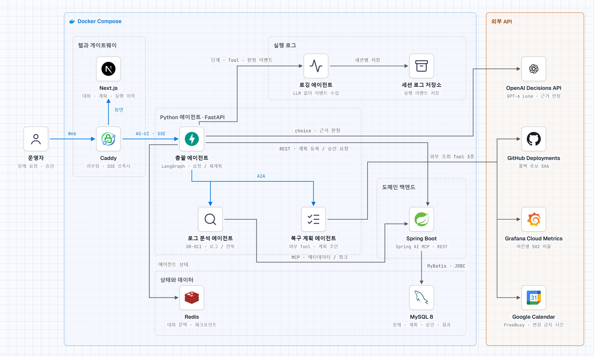

# 06. Incident-Ops-Agent 스택 다이어그램

이 그림은 결제 장애를 접수해 복구 계획을 만들고 운영자 승인을 받기까지의 **목표 아키텍처**를 보여준다.

[대화형 HTML 열기](diagrams/incident-ops-stack.html) · [다크 모드 PNG](diagrams/incident-ops-stack-dark.png)

HTML은 로컬 브라우저에서 열면 된다. 라이트·다크 모드를 전환할 수 있으며 아이콘과 스타일은 파일에 포함되어 있다.

| 영역 | 역할 |
| --- | --- |
| Next.js · Caddy | 운영자가 대화, 계획, 실행 이력을 보고 승인한다. Caddy는 화면 요청과 총괄 에이전트의 AG-UI 스트림을 중계한다. |
| FastAPI · LangGraph · A2A | 총괄 에이전트가 요청을 분석하고 Tool 호출, 제약 판단, 재계획을 조율한다. A2A로 로그 분석과 복구 계획 작성 작업을 위임한다. |
| Spring Boot · Spring AI MCP · MyBatis | 로그 분석 에이전트가 DR-DCI 방식으로 메타데이터를 찾고 필요한 본문만 가져온다. 도메인 REST API는 계획과 승인을 관리하고, MyBatis로 MySQL 8에 장애·계획·승인·복구 결과를 저장한다. |
| 외부 조회 Tool | GitHub Deployments로 후보 배포를 찾고, Grafana Cloud에서 같은 SHA의 지표를 읽고, Google Calendar FreeBusy로 변경 금지 시간을 확인한다. |
| OpenAI Decisions API · 운영자 승인 | `gpt-6-luna`의 `choice`로 계획을 뒷받침하는 근거가 충분한지 검토한다. 계획의 최종 승인과 거절은 운영자가 AG-UI에서 결정한다. |
| Redis · 로깅 에이전트 | Redis는 대화 상태와 체크포인트에 사용한다. 별도 로깅 에이전트는 단계 전환, Tool 호출, 판정 이벤트를 LLM 없이 수집해 세션별로 저장한다. 그림의 세션 로그 저장소는 논리적 구성 요소이며 저장 기술은 아직 정하지 않았다. |

결제 장애 예시에서 **GitHub가 이전 버전 `v41`의 SHA를 반환하면 Grafana에서 502 비율 0.3%를 확인**한다. 첫 작업 창인 14:28~14:33이 Calendar의 변경 금지 시간 14:30~14:40과 겹친다. 총괄 에이전트는 이전 조회 결과를 재사용해 **14:40~14:45**로 재계획하고, 근거 검토를 거쳐 운영자에게 제안한다.

[플래너와 근거 판정 흐름](04-domain-planner-and-decisions.md) · [외부 API Tool 입출력과 재계획 시나리오](05-external-api-tools.md) · [백엔드 API 및 MCP 명세](02-backend-api-and-mcp-spec.md)
