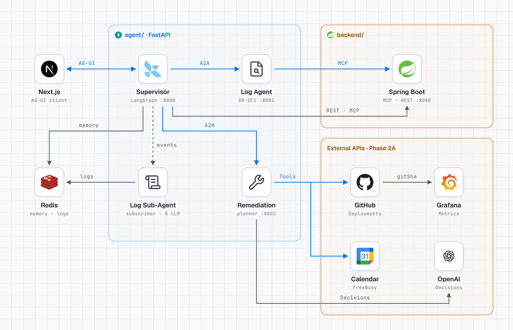

# 07. Agent 영역 Phase별 구현 계획

`backend/`(Phase 1A·1B)와 독립·병렬로 `agent/` 영역을 구현하기 위한 단계별 계획과 완료 기준이다. 모든 작업은 `agent/` 내부에 한정하며 `backend/` 코드는 수정하지 않는다.

[Phase 2 스택 다이어그램 (HTML)](diagrams/phase2-agent-stack.html) · [PNG (Light)](diagrams/phase2-agent-stack.png) · [PNG (Dark)](diagrams/phase2-agent-stack-dark.png)



---

## 1. 3대 프로토콜 및 연동 계약 요약 (변경 불가 경계)

이 프로젝트의 핵심은 **AG-UI · A2A · MCP 3대 표준 프로토콜을 모두 실제 통신으로 연결**하는 것이다.

| 프로토콜 | 구간 | 표준 규격 / SDK | 역할 |
| :--- | :--- | :--- | :--- |
| **AG-UI** | Frontend ↔ `supervisor:8000` (`/api/ag-ui`) | `ag-ui-protocol` (`RunAgentInput` + `EventEncoder` SSE) | 운영자 대화, 단계·Tool·재계획 실시간 스트리밍, 상태 동기화(`STATE_SNAPSHOT`), HITL 승인 인터럽트·재개 |
| **A2A** | `supervisor:8000` ↔ `log_agent:8001` · `remediation_agent:8002` | `a2a-sdk` (`/.well-known/agent-card.json` + JSON-RPC 2.0) | 총괄 에이전트의 로그 조사·복구 계획 작업 위임 및 결과 수신 |
| **MCP** | `agent` ↔ Spring Backend (`:8080/sse`) | `mcp` (`sse_client`, `X-Internal-Token`) | DR-DCI 코퍼스 검색/인출, 장애 상세 조회, 승인 검증 기반 복구 완료·포스트모템 확정 |

- **실행 엔트리포인트 (`docker-compose.yaml`):** 단일 `agent/Dockerfile`에서 uvicorn 앱 3개 기동
  - `supervisor.main:app` (`:8000`, Caddy `/api/ag-ui*`)
  - `log_agent.main:app` (`:8001`, Caddy `/a2a/log-agent*`)
  - `remediation_agent.main:app` (`:8002`, Caddy `/a2a/remediation-agent*`)
- **백엔드 인증:** MCP(`/sse`, `/mcp/message`)와 REST(`/api/incidents/**`) 모든 요청에 `X-Internal-Token` 헤더 전달 ([백엔드 API 및 MCP 명세](02-backend-api-and-mcp-spec.md#sse로-연결하기))
- **FastAPI 공통 필수 기준 (DI · Security):**
  - **DI (`Depends`):** `Settings`, `httpx.AsyncClient`, `Redis`, `BackendClient`, `EventBus`, 외부 Tool/Decisions 클라이언트를 전역 하드코딩 대신 FastAPI `lifespan` + `Depends`로 주입 (`app.dependency_overrides`로 테스트 교체 가능)
  - **Security:** 내부 엔드포인트(`/a2a/**`, 관리 API 등)에 `X-Internal-Token` 검증(`hmac.compare_digest`, `/health` 제외), CORS 허용 오리진 제한, 예외 핸들러에서 API 키·토큰·스택트레이스 노출 차단(NF3001·NF3002)
- **MCP vs REST 호출 구분:**
  - **MCP 4종:** `searchCorpusIndex`, `pullCorpusChunk`, `getIncidentDetail`, `completeIncidentWithPostMortem` (JSON 텍스트 응답, 검증·상태 오류 시 `isError: true`)
  - **REST 필수 2종:** `POST /api/incidents/{incidentCode}/plans`, `POST /api/incidents/{incidentCode}/approvals`

---

## 2. 디렉터리 구조 (`agent/`)

```text
agent/
├── Dockerfile                # Python 3.12-slim + dependencies, PYTHONPATH=/app/src
├── pyproject.toml            # 최소 의존성 (ag-ui-protocol, a2a-sdk, mcp, langgraph, langchain-openai, openai, fastapi, uvicorn, httpx, redis, pydantic, python-dotenv, pytest)
├── src/
│   ├── common/
│   │   ├── config.py         # 환경변수 + serviceName별 GitHub/Grafana/Calendar 매핑
│   │   ├── tools.py          # 외부 API Tool 3종 + 공통 {ok, data | error} 계약
│   │   ├── planner_math.py   # 502 비율 비교 + 변경 금지 구간 제외 작업 창 계산/재계획
│   │   ├── decisions.py      # OpenAI Decisions API (gpt-6-luna, choice)
│   │   ├── backend_client.py # Spring MCP SSE 클라이언트 + REST(plans/approvals) 클라이언트
│   │   └── event_log.py      # 발행자 독립 EventBus + 로깅 서브 Agent(LLM 0회) + Redis 세션 로그 저장소
│   ├── log_agent/main.py     # :8001 — A2A 서버(AgentCard + JSON-RPC) + DR-DCI(search → pull)
│   ├── remediation_agent/main.py  # :8002 — A2A 서버(AgentCard + JSON-RPC) + 외부 Tool 3종 + 재계획 + Decisions 판정
│   └── supervisor/
│       ├── graph.py          # LangGraph 5단계 + A2A 위임 + 대화 맥락(Memory) + 재계획 상한(3회)
│       └── main.py           # :8000 — AG-UI 엔드포인트(/api/ag-ui, RunAgentInput/EventEncoder) + HITL 승인·완료 + 실행로그/계획 조회 API
└── tests/
```

---

## 3. Phase별 구현 범위 및 완료 기준

### Phase 2A: 외부 API Tool 3종 · 제약 계산 · Decisions 판정 *(백엔드 무의존)*
- **목표:** 백엔드 없이도 외부 API 실호출, 결정론적 재계획, 근거 판정 3사례를 먼저 검증한다. ([도메인 플래너와 판정](04-domain-planner-and-decisions.md), [외부 API Tool 명세](05-external-api-tools.md))
- **구현 범위:**
  - `agent/pyproject.toml`, `agent/src/common/config.py`
  - `agent/src/common/tools.py`: `list_rollback_candidates`(GitHub Deployments), `get_release_metrics`(Grafana Cloud Prometheus), `get_change_freeze_windows`(Google Calendar FreeBusy) — 예외 미누출, 공통 실패 코드(`INVALID_INPUT`, `AUTH_FAILED`, `RATE_LIMITED`, `UPSTREAM_ERROR`, `NO_RESULT`, `INSUFFICIENT_DATA`)
  - `agent/src/common/planner_math.py`: 502 비율 비교 및 변경 금지 구간 제외 작업 창 탐색/재계획
  - `agent/src/common/decisions.py`: `gpt-6-luna` `choice` 판정 (`SUPPORTED`, `NEED_MORE_EVIDENCE`, `CONTRADICTED`, 실패 시 판정 불가)
- **완료 기준:**
  - [x] 외부 API Tool 3종 정상·실패 응답 단위 테스트 통과 (`agent/tests/test_phase2a_tools_and_decisions.py`)
  - [x] 결제 장애 시나리오(`v41` 0.3% < 1%, 14:28~14:33 충돌 → 14:40~14:45 재계획) 통과
  - [x] Decisions API 3사례(`SUPPORTED`, `NEED_MORE_EVIDENCE`, `CONTRADICTED`, 실패 시 `UNDECIDABLE`) 어댑터 단위 테스트 및 `gpt-6-luna` 실호출 검증 통과 (`conf=1.0`)

### Phase 2B: Spring MCP/REST 연동 · `log_agent` · `remediation_agent` (MCP + A2A)
- **목표:** Spring MCP(`/sse`)·REST API와 실통신하고, 두 워커 에이전트를 표준 **A2A(`a2a-sdk`)** 서버(`:8001`, `:8002`)로 독립 기동한다.
- **구현 범위:**
  - `agent/src/common/backend_client.py`: `mcp.client.sse.sse_client` + `X-Internal-Token` 헤더 기반 MCP 4종 호출 및 REST(`plans`, `approvals`, `incidents`) 호출
  - `agent/src/log_agent/main.py`: `a2a-sdk` 기반 `/.well-known/agent-card.json` + JSON-RPC 2.0(`message/send`) + DR-DCI 루프(`searchCorpusIndex` → `pullCorpusChunk`, `DR_DCI_MAX_PULL_STEPS`·`DR_DCI_MAX_CHUNK_CHARS` 적용, 근거 요약·청크 ID 반환)
  - `agent/src/remediation_agent/main.py`: `a2a-sdk` 기반 `/.well-known/agent-card.json` + JSON-RPC 2.0(`message/send`) + 외부 Tool 3종 호출 + 기존 결과 재사용 재계획 + Decisions 판정 분기
- **의존성:** Spring Backend(`:8080`, `demo` 프로필 `INC-2026-001`), `INTERNAL_SERVICE_TOKEN`
- **완료 기준:**
  - [x] 두 워커의 `/.well-known/agent-card.json` 조회 및 A2A JSON-RPC(`SendMessage`, `X-Internal-Token`) 실통신 확인 (`agent/tests/test_phase2b_mcp_and_a2a.py`)
  - [x] `log_agent`가 `INC-2026-001`에서 실기동 Spring MCP(`:8080/sse`) DR-DCI로 `LOG-104`, `RUNBOOK-01`, `RUNBOOK-02` 동적 인출 확인
  - [x] `remediation_agent`가 `NEED_MORE_EVIDENCE`(재조회) · `CONTRADICTED`(롤백 제외 수정 계획) · `SUPPORTED`(초안 반환) 3분기 및 캐시 재사용(중복 호출 0건) 처리 확인

### Phase 2C: `supervisor` (LangGraph · AG-UI · Memory) · 로깅 에이전트 · 컨테이너화
- **목표:** 프론트엔드와의 모든 대화·실행·HITL 승인 연결을 표준 **AG-UI(`ag-ui-protocol`)**로 통일하고, A2A 위임·대화 맥락·분리된 로깅 서브 에이전트·Docker 기동을 완성한다.
- **구현 범위:**
  - `agent/src/common/event_log.py`: 발행자 독립 `EventBus` + LLM 미사용 로깅 서브 에이전트 + 기존 `Redis` 세션 실행 로그 저장소(`exec_log:{session_id}`, 대화 메모리 `memory:{thread_id}`와 키 프리픽스 분리, TTL 미적용, 목록·상세·삭제만 제공, 수정 API 미제공)
  - `agent/src/supervisor/graph.py`: LangGraph 5단계(분석 → 계획 → 실행[A2A 위임] → 판단/재계획 상한 3회 → 응답) + Redis/메모리 대화 맥락(후속 요청 시 변경 조건만 갱신, Tool 원본 대신 요약 보관)
  - `agent/src/supervisor/main.py`:
    - **AG-UI 주 엔드포인트 (`POST /api/ag-ui`):** `RunAgentInput` 수신 → `EventEncoder` SSE 스트림 반환 (`RUN_STARTED`, `STEP_STARTED/FINISHED`, `TOOL_CALL_START/ARGS/END/RESULT`, `STATE_SNAPSHOT`, `TEXT_MESSAGE_START/CONTENT/END`, `CUSTOM`[HITL 승인 요청/재계획 표시], `RUN_FINISHED`/`RUN_ERROR`)
    - **HITL 승인·완료 연동:** 근거 `SUPPORTED` 시 백엔드 `POST /plans` → `POST /approvals` 등록 후 AG-UI `STATE_SNAPSHOT`/`CUSTOM`으로 운영자 승인 대기 → 운영자 승인 후 AG-UI 재개 시 MCP `completeIncidentWithPostMortem` 호출
    - **보조 관리 API:** 세션 실행 로그 조회/삭제 및 계획 관리 API
  - `agent/Dockerfile`: `docker-compose.yaml`의 3개 uvicorn 커맨드 기동 지원
- **의존성:** Redis(`:6379`), Caddy 라우팅(`infra/Caddyfile`), 프론트엔드 AG-UI 클라이언트(`@ag-ui/client` 또는 CopilotKit `HttpAgent`)
- **완료 기준:**
  - [x] `POST /api/ag-ui`에 표준 `RunAgentInput` 전송 시 AG-UI SSE 이벤트 시퀀스 정상 스트리밍 확인 (`agent/tests/test_phase2c_supervisor_agui_and_logging.py`)
  - [x] 로깅 에이전트를 연결하지 않아도 `supervisor`가 정상 응답(발행-구독 비의존성 검증)
  - [x] 재계획 시 이미 확보한 Tool 결과를 재사용(중복 호출 0건)하고 상한 3회 도달 시 중단
  - [x] `docker compose`로 `backend` + `agent` 3개 서비스 기동 및 Caddy → AG-UI → A2A → Spring MCP · 실 Redis 전체 연동 확인

### Phase 2D: 대표 시나리오 5종 & 비기능 통합 검증
- **목표:** 필수 요구사항 검증 항목과 [Phase 1 체크리스트의 복구 플래너 연동 검증](03-phase1-task-checklist.md#복구-플래너-연동-검증)을 완료한다.
- **완료 기준:**
  - [x] 대표 시나리오 5종 실행 결과(`agent/tests/test_phase2d_scenarios_and_nonfunctional.py`) 및 세션 로그 샘플 확보: ① 한 번에 충족([session-log-normal.json](../agent/samples/session-log-normal.json)) ② 시간 충돌 재계획([session-log-replan.json](../agent/samples/session-log-replan.json)) ③ 재계획 상한(3회) 도달 ④ Tool 1종 실패(서비스 미중단) ⑤ Tool 불필요 요청
  - [x] API 키·내부 오류 상세가 응답/화면·세션 실행 로그에 노출되지 않음 확인
  - [x] 미승인 상태에서 완료 호출 시 실 Spring MCP `409` 거절 및 정상 승인 후 `RESOLVED` + 포스트모템 반영 확인

### Phase 3: 심화 기능 *(Phase 2D 통과 후 선택 착수)*
- [ ] **로깅 이상 징후 판단 (F3020):** 규칙 기반 판정(동일 입력 반복, 과다 재계획, 미계획 Tool 호출, 근거 부재 시 `판정 불가`) + 이상 판정 건에만 LLM 3문장 원인 진단(정상 시 LLM 0회)
- [ ] **Planner·Worker LLM 분리 비교 (F3021):** 정상 경로 Worker LLM 호출 0회, 수정 가능한 실패(`NO_RESULT` 등)에만 고정 인자 보존 재시도 + 전후 지표 비교
- [ ] **Tool 확장 (F3022 / F3023, 선택):** Vector DB RAG Tool 또는 로컬 저장소 ↔ Google Calendar 교체형 어댑터

---

## 4. 계약 확정 및 착수 전 확인 사항

- **확정 완료 ([프론트엔드 API 명세](09-frontend-api-spec.md)):**
  - `POST /api/ag-ui` (`RunAgentInput` + `state: {}`, 스트림 열기 전 스키마 검증 실패 HTTP `400` 통일)
  - 승인 시 `approvedBy`는 서버 측 인증 컨텍스트(`DEFAULT_OPERATOR_ID` / 추후 인증 미들웨어)에서 결정하고, `APPROVED` 직후 `remediation-agent` 실행 → MCP `completeIncidentWithPostMortem` 반영까지 이어서 처리
  - 보조 관리 API는 기존 Caddy `/api/ag-ui*` 라우팅 하위의 `/api/ag-ui/sessions*`(조회·삭제), `/api/ag-ui/plans*`(CRUD + 시간 겹침 경고)로 배치
  - 새로고침 복원(`restore: true`)은 `STATE_SNAPSHOT`(`replanHistory` 포함) + `MESSAGES_SNAPSHOT` 반환
- **착수 시 확인 필요:**
  - 외부 API 환경변수 명칭(GitHub·Grafana Cloud·Google Calendar) 및 로컬 테스트용 stub/fixture 병행 여부
