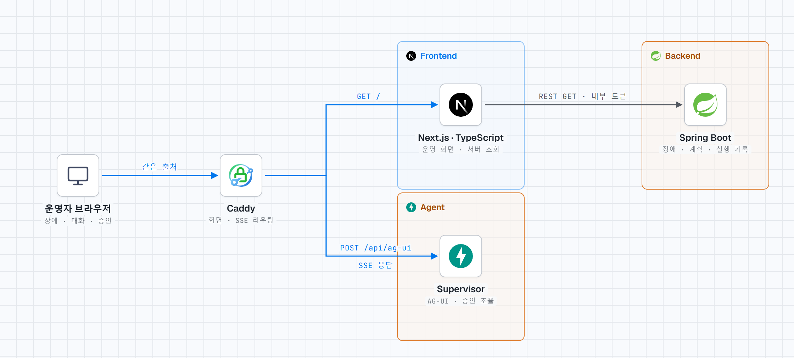

# 08. 프론트엔드 구현 계획

운영자는 한 화면에서 장애를 선택하고, 복구 계획을 요청하고, 근거를 읽은 뒤 승인하거나 반려한다. 프론트엔드는 이 과정에서 받은 진행 상태와 저장된 실행 결과를 보여준다.

## 1. 첫 화면

| 영역 | 운영자가 하는 일 | 표시할 정보 |
| --- | --- | --- |
| 왼쪽 장애 목록 | 확인할 장애 선택 | 장애 코드, 서비스, 심각도, 상태 |
| 중앙 작업 기록 | 계획 요청과 후속 메시지 입력 | 대화, 실행 단계, Tool 결과 요약, 재계획 이유 |
| 오른쪽 계획 패널 | 근거를 검토하고 승인 또는 반려 | 복구 단계, 작업 시간, 청크 ID와 근거 요약, 복구 확인 기준, 승인 상태 |

화면은 `/?incident=INC-2026-001` 형태로 선택한 장애를 주소에 남긴다. 좁은 화면에서는 장애 선택기 아래로 작업 기록과 계획을 배치한다. 실행 결과가 저장되면 같은 계획 패널에서 실행 이력과 포스트모템을 보여준다.

## 2. 기술과 연결 경로

[HTML 열기](diagrams/frontend-stack.html) · [라이트 PNG](diagrams/frontend-stack.png) · [다크 PNG](diagrams/frontend-stack-dark.png)

- Next.js App Router와 TypeScript로 구성한다. 페이지는 서버에서 장애 목록과 선택한 장애의 상세를 읽고, 클라이언트 컴포넌트는 대화와 승인 입력을 처리한다. 스타일은 CSS Modules에 두고 작업 기록과 화면 상태는 React의 `useReducer`로 관리한다. 대화와 서버 상태는 AG-UI가 전달한 데이터를 사용한다. [Next.js 서버 및 클라이언트 컴포넌트](https://nextjs.org/docs/app/getting-started/server-and-client-components)
- Caddy는 화면 요청을 Next.js로, 동일 출처의 `POST /api/ag-ui`를 Supervisor로 보낸다. 클라이언트는 `@ag-ui/client`의 `HttpAgent`로 표준 요청을 보내고 SSE 이벤트를 받는다. [현재 Caddy 라우팅](../infra/Caddyfile) · [AG-UI HttpAgent](https://docs.ag-ui.com/sdk/js/client/http-agent)
- Next.js 서버는 Spring의 `GET /api/incidents`와 `GET /api/incidents/{incidentCode}`를 호출한다. 내부 토큰은 서버 런타임 환경변수에서 읽는다. 화면에는 표시할 필드만 전달한다. 브라우저의 승인·반려 입력은 AG-UI로 보내고, Supervisor가 운영자와 승인 요청을 검증해 백엔드에 반영한다. 초기 통합은 내부 시연 환경에서 검증한다. 외부 공개 시에는 화면과 AG-UI에 운영자 인증을 적용한다. [백엔드 API 계약](02-backend-api-and-mcp-spec.md)

## 3. Gemini와 맞출 AG-UI 계약 초안

요청 JSON과 SSE 이벤트 예시는 [프론트엔드 API 명세](09-frontend-api-spec.md)에 정리했다.

| 구간 | 프론트엔드에서 필요한 계약 |
| --- | --- |
| 계획 요청 | `RunAgentInput`의 `threadId`를 같은 대화에 유지하고, 각 요청에 새 `runId`를 사용한다. `forwardedProps.incidentCode`로 장애를 지정한다. 장애 시작 시각이 필요하면 사용자에게 받아 함께 보낸다. |
| 실행 중 | 표준 대화·단계·Tool 이벤트를 작업 기록에 반영한다. `CUSTOM`에는 재계획 이유와 새 작업 시간처럼 기록에 표시할 내용을 담는다. |
| 승인 대기 | `STATE_SNAPSHOT`에서 장애 코드, 업무 진행 상태, 계획, 승인 대상(`approvalId`, `planId`, `stepNo`, 결정 상태)을 받는다. 계획에는 작업 시간과 근거 요약을 포함한다. 작성 중인 계획과 서버에 저장된 승인 대기를 업무 상태로 구분한다. |
| 승인·반려 | 같은 `threadId`의 새 실행에서 `forwardedProps.approvalDecision`에 `approvalId`와 `APPROVED` 또는 `REJECTED`를 담는다. Supervisor 응답으로 처리 결과를 확정한다. |
| 완료·복구 | 승인 이후 실제 결과와 복구 확인 정보가 접수되면 완료 상태를 받는다. 화면은 Spring 상세를 다시 읽어 실행 이력과 포스트모템을 표시한다. 새로고침이나 연결 끊김 이후에는 Spring의 저장 상태를 다시 조회하고, 대화와 진행 이력의 복원은 Supervisor의 조회 또는 재개 계약을 따른다. |

`RUN_FINISHED`는 해당 SSE 실행이 끝났음을 뜻한다. 운영자 승인 대기와 복구 완료는 업무 상태와 저장된 데이터로 판단한다. 연동 전에 Gemini와 승인 재개 입력, `STATE_SNAPSHOT`의 필드, 재계획 이벤트, 연결 중단 후 복원 방식의 예시를 합의한다. 이 예시를 프론트 모의 응답과 통합 테스트에 함께 쓴다. [Agent Phase 2C 계획](07-agent-phase-plan.md)

## 4. 프론트엔드 페이즈

### Frontend Phase 1 · 화면과 모의 흐름

- [x] `frontend/`에 Next.js와 TypeScript를 구성하고 장애 선택, 대화·작업 기록, 계획·승인 패널을 구현했다.
- [x] Chromium에서 데스크톱 승인과 모바일 반려를 검증했다. 두 흐름에서 작업 창이 14:28–14:33에서 14:40–14:45로 바뀌고 승인 대상과 버튼이 함께 표시된다.

`frontend/`에서 `npm ci`와 `npm run dev -- --port 3100`을 실행한 뒤 `http://localhost:3100`을 연다. **계획 요청**으로 재계획 흐름을 시작하고, 승인 또는 반려 후 **새 모의 실행**으로 초기화한다. 승인 결과는 실행 결과 대기까지 표시한다. [결제 장애 예시](05-external-api-tools.md#5-결제-장애-시나리오와-재계획)

### Frontend Phase 2 · AG-UI 연결

- [x] 합의한 응답 예시를 바탕으로 `HttpAgent` 구독을 연결하고, 텍스트·단계·Tool·상태 이벤트를 화면에 반영한다.
- [x] 승인·반려 후 서버 상태를 받아 버튼과 상태 표시를 갱신한다. 요청 중 중복 클릭을 막고, 장애를 바꾸면 이전 실행의 이벤트가 현재 화면에 섞이지 않는지 확인한다.
- [x] 승인 대기에서 스트림이 끝나는 경우, 실행 오류, 연결 끊김 후 다시 조회하는 경우를 검증한다.

완료 기준은 동일한 요청·응답 계약으로 모의 스트림을 확인하고, Gemini의 Phase 2C 엔드포인트가 준비되면 실제 SSE에 연결하는 것이다. [Agent 구현 계획](07-agent-phase-plan.md)

### Frontend Phase 3 · Spring 조회와 Compose 통합

- [x] Next.js 서버의 장애 목록·상세 조회를 연결하고 `frontend/Dockerfile`을 작성한다. Compose의 내부 URL과 토큰 주입은 공용 설정이므로 Agent 작업과 조율한다.
- [x] Caddy 주소 한 곳에서 장애 선택 → 복구 요청 → 재계획 → 승인 또는 반려를 검증한다. 승인 경로는 실행 결과와 복구 확인이 접수된 뒤 Spring의 완료 상태와 포스트모템을 표시한다.
- [x] 새로고침 후 저장된 장애·승인·실행 상태가 일치하는지, 브라우저 응답과 네트워크 요청에 내부 토큰이 실리지 않는지 확인한다.

완료 기준은 결제 장애 흐름을 실제 Compose에서 검증하고, Agent Phase 2D의 Tool 실패와 재계획 상한 시나리오에서 화면이 원인과 마지막 상태를 표시하는 것이다. 저장된 세션 로그의 조회·삭제나 계획 관리 화면은 대응하는 Agent API 계약이 정해지면 범위를 확정한다. [Phase 2D 완료 기준](07-agent-phase-plan.md)
