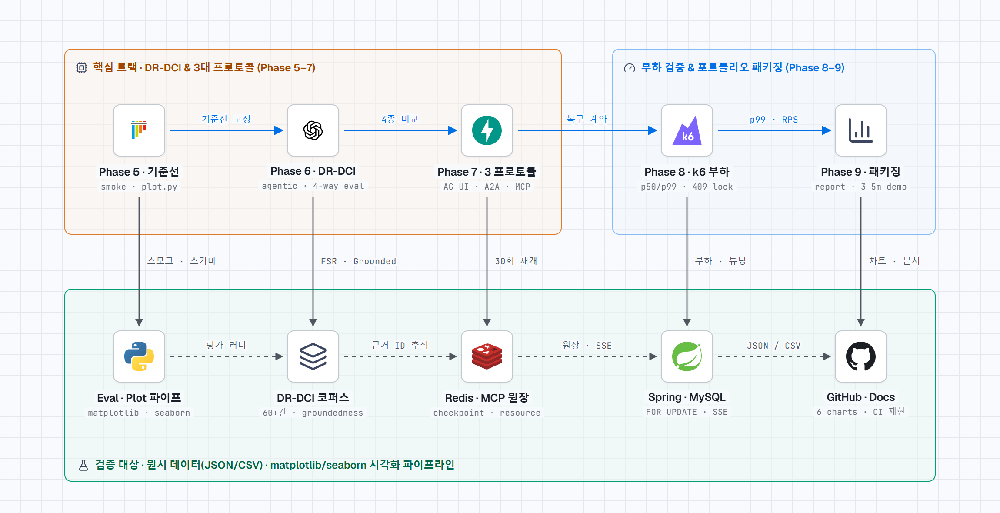

# 12. 제3 포트폴리오 고도화 로드맵 (Phase 5–9)

> **문서 목적:** `Incident-Ops-Agent`를 **3대 표준 프로토콜(AG-UI · A2A · MCP)**, **에이전틱 DR-DCI**, **정량 성능 평가(Groundedness · `p50/p95/p99` · k6 부하 테스트)**, **`matplotlib` · `seaborn` 시각화** 중심으로 고도화하기 위한 정식 실행 로드맵입니다. 상위 전략 문서(`docs/11-portfolio-expansion-strategy.md`)의 방향을 발표·검증 가능한 Phase 5–9 단위로 구체화했습니다.

[대화형 HTML 열기](diagrams/portfolio-roadmap.html) · [PNG (Light)](diagrams/portfolio-roadmap.png) · [PNG (Dark)](diagrams/portfolio-roadmap-dark.png)

---

## 1. 포트폴리오 핵심 메시지

> **"장애 대응 에이전트가 어떤 근거를 선택했고, 근거가 부족하거나 중간에 연결·프로세스가 끊겼을 때 어떻게 안전하게 멈추고 재개하는가 — 그리고 이를 정량 지표와 부하 테스트로 증명한다."**

MVP(Phase 1–4)에서 이미 AG-UI · A2A · MCP 연결과 승인 원장 통제를 구현했습니다. Phase 5–9에서는 **두 가지 질문에 수치와 재현 가능한 그래프로 답하는 것**이 목표입니다.

1. **DR-DCI 정량 우위:** 같은 장애 코퍼스에서 검색 전략을 바꿨을 때(전체 컨텍스트 / 벡터 RAG / 키워드 DR-DCI / 에이전틱 DR-DCI) **토큰·레이턴시(`p50/p95/p99`)·Groundedness·위험 오승인율(FSR)**이 어떻게 달라지는가?
2. **프로토콜·백엔드 내구성:** 실행 중 연결 단절·프로세스 재시작·동시 승인 경합이 발생해도 **AG-UI 상태, A2A 작업, MCP 근거, Spring 승인 원장**이 왜 어긋나지 않는가?

---

## 2. 현재 위치 (Baseline)와 공백

> 아래 표는 **Phase 5 착수 시점**의 기준선입니다. 표의 공백 중 일부(체크포인터, A2A 스트리밍, MCP 리소스, 에이전틱 DR-DCI, 시각화 등)는 이후 페이즈에서 구현했습니다. 현재 구현·검증 상태는 [검증 결과서](10-verification.md)를 기준으로 합니다.

| 영역 | 현재 확인된 구현·검증 | 포트폴리오 관점의 공백 |
| :--- | :--- | :--- |
| **MVP (Phase 1–4)** | Spring REST/MyBatis/Flyway/MCP, Agent 3종(`supervisor`·`log_agent`·`remediation_agent`), Next.js 워크스페이스·로그/계획 관리 구현 완료. 대표 시나리오 5종 검증([검증 결과서](10-verification.md)). | 결제 서비스 502 시나리오 1종 중심, 복구 실행 시뮬레이션, 템플릿 포스트모템. |
| **AG-UI** | 표준 SSE 스트리밍, Redis 스냅샷 새로고침 복원, 승인/반려 및 승인 실행 재개 구현. | **화면 복원 ≠ 실행 체크포인트 재개.** 영속 LangGraph 체크포인터 미적용, 연결 단절 시 실행 태스크 정리. 프로세스 재시작 후 이어서 실행 검증 부재. |
| **A2A · MCP** | 실제 A2A JSON-RPC 위임, Spring MCP `@Tool` 4종 호출 및 승인 원장 강제 검증(`409 Conflict`). | A2A는 `SendMessage`·`streaming=False`·인메모리 작업 저장소. MCP는 SSE 도구 중심(리소스 계약 없음), 내부 토큰은 사용자 인증을 대신하지 못함. |
| **DR-DCI** | MCP `searchCorpusIndex` → `pullCorpusChunk` 키워드 점수 기반 단건 인출 및 요약 컨텍스트 유지. | 첫 인출 결과에 따라 다음 청크를 고르는 **에이전틱 루프** 부재. 전체 컨텍스트·벡터 RAG 대비 정량 비교 실측 없음. |
| **P0-1 EvidenceJudge** | `EvidenceJudge` 3종 어댑터(`decisions_api` · `structured_output` · `rule_based`) 및 평가 하네스 구축 완료(`origin/main` PR #16 병합, 기본 CI PR #15 반영). | 커밋된 실측은 규칙 기반 1종(합성 30건: 정확도 **86.7% (26/30)**, Macro-F1 **0.868**, FSR **0/20**, 인젝션 차단 **3/3**). 라이브 판정기 비교, 검색 포함 종단 평가, 시각화 그래프 부재. |
| **부하·성능 검증** | 단위/기능 테스트 위주. Planner·Worker 75% 호출 절감은 호출 구조 기반 산술값. | Spring REST/MCP/MySQL 락 경합, AG-UI SSE 동시 스트리밍, tail latency(`p99`) 실측 데이터 부재. |

---

## 3. 페이즈별 상세 계획 (Phase 5–9)

아래 수치 기준은 실측 결과가 아니라 각 페이즈의 **완료 목표(Exit Criteria)**입니다.

### Phase 5 · 기준선 고정 및 평가·시각화 파이프라인 구축
- **우선순위 / 기간:** 필수 · 4–5일 (난이도 낮음–중간)
- **목표:** P0-1을 재구현하지 않고 현재 MVP의 기준선을 한 커밋·한 절차로 고정하며, 이후 모든 실험 결과를 자동으로 그래프화할 **`matplotlib` + `seaborn` 파이프라인**을 먼저 구축합니다.
- **핵심 산출물:**
  - `main` 기준 통합 및 문서(`README.md`, `docs/10-verification.md`)와 최신 코드 간 불일치 정리
  - 프런트엔드 통합 테스트 픽스처 분리: Next `/bff/mock-ag-ui` 3건과 실제 Spring SSR/BFF 1건의 실행 경로 분리 및 SSR/BFF 전용 완료 픽스처 준비
  - 외부 API 키 없이 동작하는 Compose 스모크 테스트 스크립트
  - 공통 평가 원시 스키마(`docs/eval/results/*.json`, `*.csv`) 및 시각화 모듈(`agent/src/eval/plot.py`, `matplotlib` + `seaborn`)
  - 기존 키워드 DR-DCI의 기준선 수치(선택 청크 ID, 인출 횟수, 토큰, 지연) 저장
- **완료 기준:**
  - 깨끗한 DB에서 **승인·완료 / 반려 / 워커 실패 보류** 실스택 시나리오 **3/3** 통과
  - 프런트엔드 통합 테스트 **4/4** 통과
  - 동일 커밋·데이터셋에서 P0-1 규칙 기반 30건 재현 및 초기 기준선 차트 자동 생성 (라이브 `structured_output`은 실행 가능 시 별도 기록, `decisions_api` 미실행 시 미측정 명시)

---

### Phase 6 · 에이전틱 DR-DCI 구현 및 4종 검색 전략 정량 벤치마크
- **우선순위 / 기간:** 최우선 · 2–3주 (난이도 높음)
- **목표:** 모델이 색인과 **이미 확인한 근거/부족한 근거**를 보고 `다음 청크 / 종료 / 근거 부족`을 판단하는 읽기 전용 에이전틱 DR-DCI를 구현하고, 4개 전략을 동일 조건으로 정량 비교합니다.
- **핵심 산출물:**
  - **에이전틱 DR-DCI 루프 (`log_agent`):** 장애·서비스 스코프, 중복 인출 방지, 호출·토큰·시간 예산은 서버 코드가 강제. 로그·런북 본문은 비신뢰 데이터로 격리하며 쓰기·승인 권한은 부여하지 않음.
  - **버전 고정 평가 코퍼스:** 커넥션 풀 고갈, OOM, 외부 의존성 장애, 비가역 DB 마이그레이션, 지표 누락 등 **5종 이상 · 60건 이상** (개발/평가 세트 장애 원형 분리, 다중 청크 조합 및 근거 부재 사례 포함).
  - **4종 동일 입력 비교 러너:**
    1. `full_context` (전체 코퍼스 투입)
    2. `vector_rag` (임베딩 벡터 검색 Top-K)
    3. `keyword_dr_dci` (기존 키워드 점수 기반 DR-DCI — **임베딩 미사용 효과 분리용 필수 비교군**)
    4. `agentic_dr_dci` (모델 주도 다단계 DR-DCI)
  - **프로토콜 연계:** MCP(색인·청크 실공급) → A2A(조사 목표·선택 근거 ID·요약 전달) → AG-UI(확인된 근거와 부족한 근거 실시간 표시).
- **완료 기준:**
  - 4종 전략의 **Evidence Recall, Citation Validity, Groundedness / Ungrounded Rate, Macro-F1, FSR(분자/분모), 입력·출력 토큰(선택기 비용 포함), 종단 `p50/p95/p99`, 호출 수**를 단일 표와 `matplotlib`/`seaborn` 차트(①–④)로 공개
  - 기본 전략 채택 목표: 전체 컨텍스트 대비 **총 입력 토큰 30% 이상 절감**, Macro-F1 하락 **5%p 이내**, FSR **5% 이하**, 예산 초과·비인가 쓰기 **0건**
  - 목표 미달 시 기존 키워드 DR-DCI를 기본값으로 유지하고, 에이전틱 방식이 불리했던 원인과 사례를 투명하게 공개 (**실험 완료 ≠ 무조건 채택**)

---

### Phase 7 · 3대 프로토콜(AG-UI · A2A · MCP) 실패·복구 계약 고도화
- **우선순위 / 기간:** 필수 · 2–3주 (난이도 높음)
- **목표:** 실행 도중 연결이 끊기거나 프로세스가 재시작돼도 UI 상태, 워커 작업, 근거, 승인 원장이 어긋나지 않음을 계약 테스트와 반복 실험으로 증명합니다.

| 프로토콜 경계 | 핵심 산출물 | 완료 기준 (Exit Criteria) |
| :--- | :--- | :--- |
| **AG-UI (재연결·실행 재개)** | 영속 LangGraph 체크포인터, 재접속 시 이벤트 순번/스냅샷 동기화, 명시적 취소 vs. 단순 연결 단절 분리 (`RUN_FINISHED` ≠ 업무 `RESOLVED` 유지) | **근거 수집 중 / 승인 대기 중 / 완료 저장 후 응답 전** 3개 지점 각 **10회** 중단·재개(총 30회) → 완료 단계 불필요 재호출 **0건**, 승인당 실행·포스트모템 중복 **0건**, UI-Spring 상태 불일치 **0건** |
| **A2A (작업 수명주기·위임)** | 조사 워커 1개에 표준 스트리밍 적용(작업 ID, 진행 상태, 최종 산출물, 타임아웃·취소), Supervisor→AG-UI 상태 매핑, 제한된 병렬 위임 또는 동일 계약 워커 교체 실증 | 정상·타임아웃·취소·중복 요청·워커 교체 **5개 계약 시나리오** 통과, 진행 이벤트 선행 도착 확인 및 첫 이벤트 `p95` 기록, 재시도 정책 외 중복 작업 **0건** |
| **MCP (리소스·도구·권한)** | 기존 `@Tool` 4종 유지 + 버전 있는 읽기 전용 **근거 요약 리소스** 1종 추가, 조사 워커(읽기) vs. 완료(쓰기) 권한 분리, Spring 승인 원장 검증 유지 | 독립 MCP 클라이언트로 도구 목록·리소스 조회 실통신 확인; 잘못된 토큰·타 장애 접근·조사 워커 쓰기·미승인 완료 **4개 부정 계약 허용 0건** |

- **공통 산출물:** `AG-UI 실행 ID → A2A 작업 ID → MCP 호출·청크 ID → Spring 승인 ID` 종단 트레이스. (공개 배포는 사용자 인증·인가 도입 전까지 보류하며 로컬·신뢰 환경 전제 유지)

---

### Phase 8 · k6 백엔드·프로토콜 부하 테스트 및 병목 튜닝
- **우선순위 / 기간:** 필수 · 1–1.5주 (난이도 중간–높음)
- **목표:** **k6**로 백엔드(Spring REST/MCP/MySQL)와 실시간 프로토콜(Caddy/AG-UI SSE/A2A)의 한계 성능과 동시성 안전성을 실측하고, 발견된 병목 **1–2건을 튜닝한 뒤 전·후 수치와 그래프**를 비교합니다.
- **k6 테스트 스위트 (`loadtest/k6/`):**
  1. **`read-mix.js` (Spring REST + MCP 읽기 혼합):** 장애 목록/상세 + MCP `searchCorpusIndex`/`pullCorpusChunk` 단계적 부하(예: 10 → 50 → 100 → 200 VU) — RPS, `p50/p95/p99`, 에러율, HikariCP/MySQL 포화 지점 측정.
  2. **`approval-contention.js` (승인 원장 동시성 경합):** 동일 `incidentCode`에 동시 승인/완료 요청 폭주(`SELECT ... FOR UPDATE` 락 경합) — 락 대기 `p95/p99`, 정상 `2xx` vs. 의도된 `409 Conflict` vs. `5xx`(목표 `0%`), 중복 실행·중복 포스트모템 **0건** 검증.
  3. **`ag-ui-sse-stream.js` (AG-UI SSE + Caddy + Redis 동시 스트리밍):** 다중 운영자 동시 SSE 구독 및 스냅샷 복원 — 동시 연결 유지율, 첫 이벤트 지연(TTFT) `p50/p95/p99`, 연결 드롭률 측정.
  4. **`e2e-protocol-breakdown.js` (3대 프로토콜 구간별 지연 분해):** 오프라인 mock 외부 API 조건에서 AG-UI / A2A / MCP / DB 각 구간의 지연 비중 측정.
- **완료 기준:**
  - k6 원시 요약(`--summary-export` JSON 및 시계열 CSV)을 `docs/eval/results/k6/`에 저장
  - `matplotlib` + `seaborn`으로 **부하 곡선(차트 ⑤)** 및 **병목 튜닝 전·후 비교(차트 ⑥)** 생성 (하드웨어 스펙, Docker 리소스 제한, 커밋 해시 함께 기록)
  - 동시성 경합 테스트에서 `5xx` **0%**, 승인당 실행·포스트모템 중복 **0건**

---

### Phase 9 · 포트폴리오 증거 패키징 및 시연 영상 촬영
- **우선순위 / 기간:** 필수 · 3–5일 (난이도 낮음)
- **목표:** 면접관·리뷰어가 시연 영상과 저장소 문서만으로 설계 판단, 정량 수치의 출처, 재현 커맨드를 바로 검증할 수 있게 마감합니다.
- **핵심 산출물:**
  - 최종 벤치마크·부하 테스트 종합 리포트 (`docs/eval/` + `README.md` 요약 차트 임베드)
  - 3대 프로토콜 시퀀스 및 실패 경계 요약 문서
  - 외부 API 키 없이 실행 가능한 오프라인 평가·차트 재생성·k6 스모크 재현 가이드
  - **시연 영상 촬영본 (3–5분, 필수 산출물)** 및 촬영 시나리오:
    1. **정상 승인 흐름 (`0:00–1:30`):** AG-UI 실시간 스트리밍 → A2A 워커 위임 & MCP DR-DCI 청크 인출 근거 확인 → 운영자 승인 → `RESOLVED` 전이
    2. **안전 차단 흐름 (`1:30–2:30`):** 근거 부족 또는 충돌 장애에서 `BLOCKED` 보류 및 미승인 완료 요청 `409 Conflict` 차단 화면
    3. **중단 후 재개 (`2:30–3:30`):** 실행 도중 연결 단절/프로세스 재시작 → 체크포인트 기반 이어서 실행 및 UI-Spring 원장 상태 일치 검증
    4. **정량 평가·부하 결과 (`3:30–4:30`):** 4종 DR-DCI 비교 차트(`matplotlib`/`seaborn`), 에이전틱 방식이 불리했던 사례 1건, k6 부하 테스트·튜닝 전후 `p99`/RPS 그래프 해설

---

## 4. 정량 지표 및 `matplotlib` · `seaborn` 시각화 명세

### 4.1 핵심 지표 정의
- **레이턴시:** `p50`, `p95`, `p99`, TTFT(첫 이벤트 도달 시간) — 모델/검색 단계별 및 k6 요청별 모두 측정
- **근거 충실도 (Groundedness):**
  - `Citation Validity`: 응답에 인용된 `chunk_id` 중 실제 `pullCorpusChunk`로 인출된 비율
  - `Evidence Recall`: 정답 필수 근거 청크 중 실제로 인출된 비율
  - `Ungrounded Rate` (무근거 주장 비율): 인출 근거에 없는 수치·원인·명령을 생성한 비율
- **안전성:** `FSR (False-Supported Rate)` = 비승인 정답(`NEED_MORE_EVIDENCE` · `CONTRADICTED`)을 `SUPPORTED`로 오판한 비율(분자/분모 병기), `Injection Resistance`(간접 프롬프트 인젝션 차단율)
- **시스템 부하:** RPS, `p50/p95/p99`, `2xx`/`409`/`5xx` 분포, 락 대기 시간, 중복 쓰기 0건

### 4.2 자동 생성 차트 6종 (`agent/src/eval/plot.py`)
원시 결과(`docs/eval/results/*.json`, `*.csv`)를 입력받아 단일 명령으로 고해상도 PNG(`300 dpi`)를 재생성합니다.

| # | 차트 이름 | 시각화 유형 (`matplotlib` / `seaborn`) | 증명하려는 질문 |
| :---: | :--- | :--- | :--- |
| **①** | **4종 검색 전략 파레토 차트** | `sns.scatterplot` (x=입력 토큰, y=Macro-F1/Groundedness, size=`p99`, hue=전략) | DR-DCI가 전체 컨텍스트·벡터 RAG 대비 비용/품질 균형이 어떻게 다른가? |
| **②** | **Groundedness · 안전성 비교 & 혼동 행렬** | `sns.barplot` + `sns.heatmap` | 전략·판정기별 무근거 주장(Ungrounded Rate)·FSR·인젝션 방어율 차이는? |
| **③** | **에이전트 레이턴시 분포 (`p50/p95/p99`)** | `sns.boxplot` / `violinplot` + 단계별 누적 막대 | tail latency(`p99`)가 어느 구간(MCP / 도구 / 판정)에서 발생하는가? |
| **④** | **DR-DCI 인출 예산 곡선** | `sns.lineplot` (x=`DR_DCI_MAX_PULL_STEPS`, y=Recall & 토큰 2축) | 인출 스텝 상한이 근거 회수율과 비용에 미치는 수확 체감 지점은 어디인가? |
| **⑤** | **k6 부하 테스트 성능 곡선** | `sns.lineplot` (x=VU, y=RPS & `p50/p95/p99` + 응답 코드 비율) | Spring/MySQL/SSE의 포화 지점과 동시 승인 `409` 방어는 안정적인가? |
| **⑥** | **병목 튜닝 전·후 비교** | `sns.barplot` / `sns.ecdfplot` (Before vs. After) | 발견한 병목(인덱스·풀·캐시·비동기 등) 개선으로 `p99`와 RPS가 얼마나 개선됐는가? |

---

## 5. 우선순위 트랙 및 발표 스토리라인

### 반드시 끝낼 핵심 트랙 (Must-have)
1. **Phase 5 기준선 + `matplotlib/seaborn` 파이프라인**
2. **Phase 6 4종 검색 비교** (특히 **기존 키워드 DR-DCI를 비교군에 반드시 포함**해 임베딩 미사용 효과와 에이전틱 선택 효과를 분리)
3. **Phase 7 재시작 후 안전한 재개 1개 종단 흐름** (시간 부족 시 MCP 리소스 1종, A2A 스트리밍 워커 1개로 범위 고정)
4. **Phase 8 k6 핵심 부하 2종(읽기 혼합 + `409` 동시성 경합) & 튜닝 전·후 그래프**

### 여유 시 확장 트랙 (Nice-to-have)
- 로컬 `kind` 클러스터 실제 롤백 및 지표 기반 정상화 검증
- 운영자 인증·RBAC·승인 만료 및 감사 강화 (공개 배포 시 필수 선행 조건)
- 추가 A2A 워커 및 Alertmanager · OpenTelemetry 연동

### 포트폴리오 발표 흐름
> **결제 장애 MVP** → **동일 장애 60+건에서 4종 검색 전략의 토큰·Groundedness·FSR·`p99` 실측 비교** → **중단·재시작에도 AG-UI/A2A/MCP와 승인 원장이 깨지지 않음을 30회 실험으로 증명** → **k6 동시 부하·`409` 경합 테스트와 병목 튜닝 전·후 그래프로 백엔드 내구성 입증**
