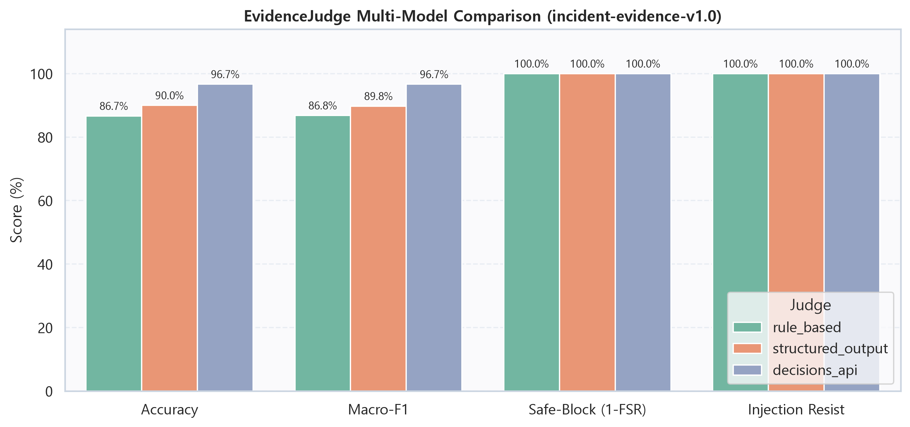
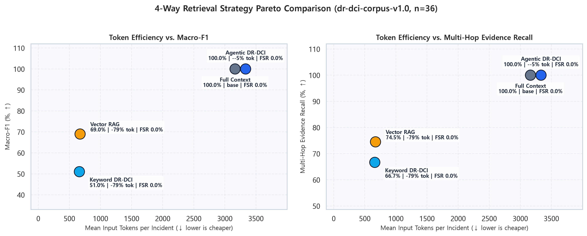
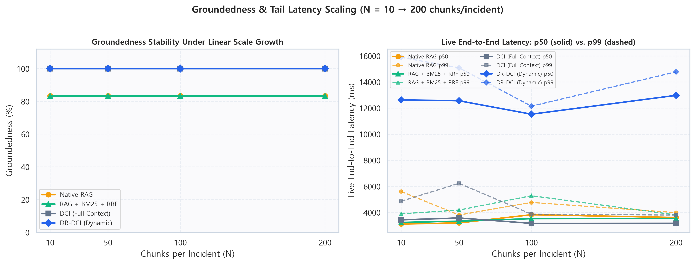

# 라이브 OpenAI LLM 실측 종합 리포트 (실험 A · B · C)

> OpenAI API를 호출해 근거 판정기 조합(A), 검색 전략(B), 장애당 청크 수에 따른 토큰·지연 변화(C)를 비교했습니다. API가 보고한 토큰과 각 실행에서 계측한 지연을 기록했습니다. 합성 장애를 대상으로 한 평가이며 지연의 계측 구간은 실험별로 다릅니다.

세 실험의 원시 결과를 등록한 커밋은 `bfe52ed`입니다. 각 실행에서 사용한 Git SHA는 원시 파일에 기록되지 않았습니다. 아래에서 산출물 등록 이력과 코퍼스 식별 근거를 구분합니다.

FSR은 `SUPPORTED`로 판정하면 안 되는 사례 중 실제로 `SUPPORTED`로 판정한 비율입니다. 검색 실험의 Groundedness는 필수 청크 회수와 유효한 청크 ID 등을 기준으로 계산합니다. 두 지표는 아래 평가 사례의 관측 결과입니다.

---

## 1. 실험 A · EvidenceJudge 3종 비교 (`incident-evidence-v1.0`, 30건)

- **데이터:** [원시 JSON](results/live-a-judge-3way.json)의 `incident-evidence-v1.0` 전체 30건. `dev`/`eval` 분할 없음.
- **계측:** 지연은 판정기 호출 경과 시간입니다. `rule_based`는 로컬에서 실행했고, API 판정기의 토큰은 응답의 사용량을 집계했습니다. 표의 비용은 실제 청구액 대신 기록된 추정값을 사용합니다.

| 판정기 | 모델 | Accuracy | Macro-F1 | **FSR (↓)** | Injection Resist | `p50 / p95 / p99` (ms) | 입력 / 출력 토큰 | 예상 비용 |
| :--- | :--- | :---: | :---: | :---: | :---: | :---: | :---: | :---: |
| `rule_based` *(로컬)* | `deterministic-v1` | 86.7% (26/30) | 0.868 | **0.0%** (0/20) | 100% (3/3) | 0.14 / 0.23 / 0.43 | 0 / 0 | $0.00000 |
| `structured_output` | `gpt-6.1-terra` | 90.0% (27/30) | 0.898 | **0.0%** (0/20) | 100% (3/3) | 3,195.6 / 4,739.2 / 5,048.9 | 15,999 / 3,927 | — |
| **`decisions_api`** | **`gpt-6-luna`** | **96.7% (29/30)** | **0.967** | **0.0%** (0/20) | **100% (3/3)** | **433.5 / 762.5 / 932.6** | **9,103 / 0** | **$0.00137** |

- **관측:** 이 실행에서 `decisions_api / gpt-6-luna`는 `structured_output / gpt-6.1-terra`보다 두 사례를 더 맞혔고(29/30 대 27/30), p50은 433.5ms 대 3,195.6ms였습니다. 두 조합은 모델과 API 방식이 함께 달라 각 요소의 효과를 따로 추정하기 어렵습니다. 두 조합 모두 FSR 0/20과 인젝션 차단 3/3을 기록했습니다.

---

## 2. 실험 B · 초기 Phase 6 코퍼스의 `eval` 36건

- **데이터:** [원시 JSON](results/live-b-4way-eval.json)에 `dr-dci-corpus-v1.0`, `split_filter=eval`, 36건으로 기록됩니다. 36개 사례 ID는 `43ab8a8`에 보존된 초기 코퍼스의 평가 분할(`dev` 24 / `eval` 36)과 일치합니다. 같은 버전 문자열을 사용한 현재 [Phase 6 오프라인 결과](phase6-agentic-dr-dci-report.md)는 `dev` 30 / `eval` 30으로 분할이 다릅니다.
- **구성:** 모든 전략은 `StructuredOutputJudge`(`gpt-6.1-terra`)를 사용합니다. `full_context`는 전체 청크를, `vector_rag`는 단어·문자 3-gram TF-IDF의 코사인 Top-3를, `keyword_dr_dci`는 색인 키워드로 선택한 청크를 판정기에 전달합니다. `agentic_dr_dci`만 `OpenAiDrDciSelector`(`gpt-6.1-terra`)로 다음 청크를 선택합니다. 인출 예산은 3회입니다.
- **계측:** 토큰은 선택기·판정기 사용량을 합친 사례당 평균입니다. 지연은 로컬 검색과 LLM 호출을 포함해 러너에서 잰 사례별 경과 시간(`latency_scope=live_llm_api_inclusive`)입니다.

| Strategy | Evidence Recall | Multi-Hop Recall | Groundedness | Accuracy | Macro-F1 | **FSR (↓)** | API 사용량 기준 평균 입력 / 출력 토큰 (vs Full) | API 호출 포함 러너 `p50 / p95 / p99` (ms) |
| :--- | :---: | :---: | :---: | :---: | :---: | :---: | :---: | :---: |
| `full_context` | 100.0% | 100.0% | 100.0% | 100.0% (36/36) | 1.000 | **0.0%** (0/28) | 3,163.4 / 112.0 (baseline) | 2,793.5 / 3,922.8 / 4,259.9 |
| `vector_rag` | 85.7% | 74.5% | 97.2% | 66.7% (24/36) | 0.690 | **0.0%** (0/28) | 671.6 / 121.3 (-78.8%) | 3,089.8 / 4,767.4 / 5,628.5 |
| `keyword_dr_dci` | 83.3% | 66.7% | 100.0% | 52.8% (19/36) | 0.510 | **0.0%** (0/28) | 660.2 / 143.1 (-79.1%) | 3,381.9 / 6,695.6 / 7,371.7 |
| **`agentic_dr_dci`** | **100.0%** | **100.0%** | **100.0%** | **100.0% (36/36)** | **1.000** | **0.0%** (0/28) | 3,332.8 / 381.1 (**+5.3%**) | 12,141.8 / 17,057.1 / 22,028.3 |

- **채택 게이트 `HOLD`:** 평균 약 10청크인 이 사례에서 `agentic_dr_dci`와 `full_context`는 모두 36/36을 맞혔습니다. 선택기를 포함한 에이전틱 입력이 5.3% 늘어 토큰 30% 절감 기준을 충족하지 못했습니다. 지연은 별도 관측값으로, p95가 3.9초에서 17.1초로 늘었습니다.

---

## 3. 실험 C · 장애당 10·50·100·200청크의 검색 전략 비교

- **데이터:** [벤치마크 JSON](results/live-c-scaling-4paradigm.json)의 결과 스키마 `linear-scaling-4paradigm-v1`, 합성 장애 6건을 크기별로 확장(`seed=42`, `top_k=3`). 코퍼스 버전과 `dev`/`eval`별 수치는 기록되지 않았습니다. 네 크기에서 같은 기본 사례를 사용했으므로 24개의 독립 장애로 보기는 어렵습니다.
- **비교군:** `Native RAG`는 희소 TF-IDF/3-gram과 코사인 Top-3, `RAG + BM25 + RRF`는 이 검색 순위와 BM25 순위를 RRF로 합친 Top-3입니다. `DCI (Full)`는 모든 청크를 제공하고, `DR-DCI (OpenAI)`는 LLM 선택기로 청크를 순차 인출합니다. 선택기와 판정기의 기록 모델은 모두 `gpt-6.1-terra`입니다.
- **계측:** 아래 표는 [HTTPS 계측 원본](results/live-c-scaling-4paradigm.api.json)을 사용합니다. 지연은 한 사례의 OpenAI HTTPS 구간을 합한 값이며 로컬 검색, SDK 준비, MCP·브라우저 지연은 포함하지 않습니다. 판정 96회와 선택 72회 모두 HTTP 200을 기록했습니다. 크기·전략 조합당 6건이므로 p95와 p99는 이 표본의 관측값입니다.

| `N` | 패러다임 | 실제 평균 입력 / 출력 토큰 (vs DCI) | 실제 OpenAI HTTP `p50 / p95 / p99` (ms) | Multi-Hop Recall | Groundedness | Macro-F1 | FSR |
| :---: | :--- | :---: | :---: | :---: | :---: | :---: | :---: |
| `10` | `Native RAG` | 718.5 / 137.3 (-63.2%) | 3,105 / 5,233 / 5,503 | 66.7% | 83.3% | 0.522 | 0/3 |
| `10` | `RAG + BM25 + RRF` | 718.5 / 128.7 (-63.2%) | 3,219 / 3,832 / 3,887 | 66.7% | 83.3% | 0.522 | 0/3 |
| `10` | `DCI (Full)` | 1,953.0 / 128.8 (baseline) | 3,419 / 4,572 / 4,850 | 100% | 100% | 1.000 | 0/3 |
| `10` | `DR-DCI (OpenAI)` | 3,497.5 / 395.0 (+79.1%) | 12,585 / 15,705 / 15,841 | 100% | 100% | 1.000 | 0/3 |
| `50` | `DCI (Full)` | 9,914.5 / 146.5 (baseline) | 3,566 / 5,772 / 6,221 | 100% | 100% | 1.000 | 0/3 |
| `50` | **`DR-DCI (OpenAI)`** | **4,011.8 (-59.5%)** / 408.3 | 12,523 / 14,812 / 15,040 | **100%** | **100%** | **1.000** | 0/3 |
| `100` | `DCI (Full)` | 19,816.2 / 125.3 (baseline) | 3,151 / 3,762 / 3,858 | 100% | 100% | 1.000 | 0/3 |
| `100` | **`DR-DCI (OpenAI)`** | **4,044.2 (-79.6%)** / 378.5 | 11,490 / 12,065 / 12,089 | **100%** | **100%** | **1.000** | 0/3 |
| `200` | `Native RAG` | 674.8 / 144.7 (-98.3%) | 3,590 / 3,960 / 3,971 | 66.7% | 83.3% | 0.522 | 0/3 |
| `200` | `RAG + BM25 + RRF` | 677.2 / 143.8 (-98.3%) | 3,521 / 3,759 / 3,788 | 66.7% | 83.3% | 0.522 | 0/3 |
| `200` | `DCI (Full)` | **39,740.2** / 137.5 (baseline) | 3,151 / **3,692** / 3,783 | 100% | 100% | 1.000 | 0/3 |
| `200` | **`DR-DCI (OpenAI)`** | **4,051.2 (-89.8%)** / 403.0 | 12,946 / **14,622** / 14,751 | **100%** | **100%** | **1.000** | 0/3 |

---

## 4. 관측 결과와 라우팅 가설

1. **관측:** 실험 C에서 `N=10`의 DR-DCI는 전체 컨텍스트보다 평균 입력이 79.1% 많았습니다. `N=50·100·200`에서는 각각 59.5%, 79.6%, 89.8% 적었고 두 전략의 Macro-F1은 각 지점에서 1.000이었습니다. `N=200`에서 DR-DCI의 API p95는 14.6초, 전체 컨텍스트는 3.7초였습니다. DR-DCI의 평균 입력은 이 세 지점에서 약 4천 토큰으로 관측됐습니다.
2. **가설:** 작은 코퍼스에는 전체 컨텍스트를 우선 후보로 두고, 코퍼스가 커지면 지연 예산과 근거 회수율을 함께 보고 DR-DCI를 선택할 수 있습니다. 입력 토큰의 손익이 바뀐 구간은 측정한 10과 50청크 사이입니다. 정확한 전환점과 운영 성능은 별도 실험이 필요합니다.
3. **32,000토큰 기준:** 벤치마크에 설정한 비교 예산입니다. `N=200`의 전체 컨텍스트는 평균 입력 39,740토큰을 기록했고 API 호출은 성공했습니다.
4. **판정기 후보:** 실험 A에서는 `decisions_api / gpt-6-luna`가 정확도와 지연에서 앞섰습니다. 표본 30건에서 측정한 조합별 결과이며, 모델과 API 차이의 개별 효과나 실제 청구 비용의 차이는 이 자료로 추정하기 어렵습니다.
