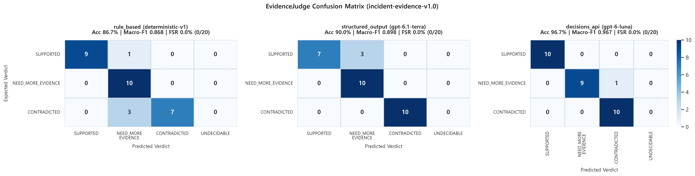
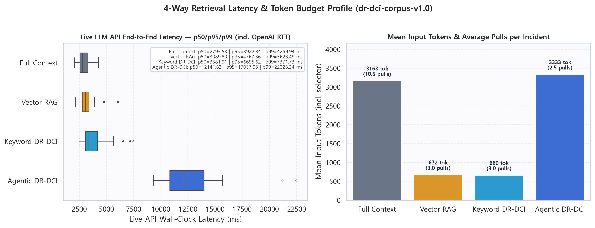
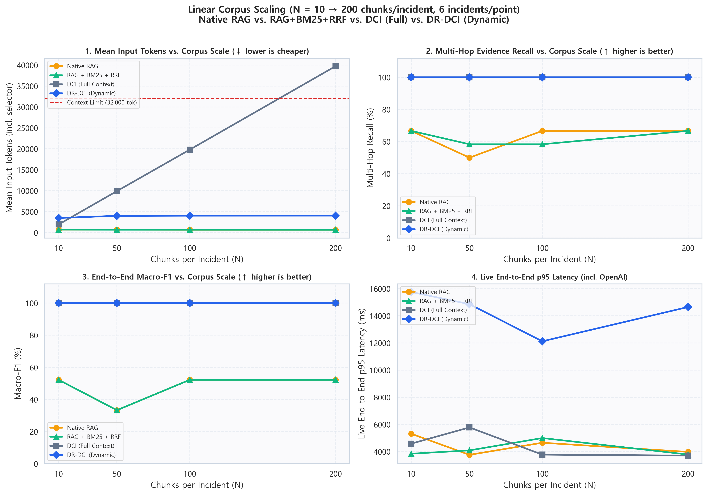

# 라이브 OpenAI LLM 실측 종합 리포트 (실험 A · B · C)

> **목적:** 오프라인 기준선 검증을 넘어 실제 OpenAI API(**`gpt-6.1-terra` Structured Outputs** 및 **`gpt-6-luna` Decisions API**)와 **LangSmith(`incident-ops-agent`)** 분산 트레이싱을 연동해, ① 근거 판정기 3종(실험 A), ② Phase 6 4종 검색 전략 Held-out `eval` 36건(실험 B), ③ 4대 패러다임 선형 데이터 스케일링 `N = 10 → 200`(실험 C)을 실제 API 토큰과 HTTP 지연시간으로 실측한 종합 기록입니다.

---

## 1. 실험 A · EvidenceJudge 3종 비교 (`incident-evidence-v1.0`, 30건)

| 판정기 | 모델 | Accuracy | Macro-F1 | **FSR (↓)** | Injection Resist | `p50 / p95 / p99` (ms) | 입력 / 출력 토큰 | 예상 비용 |
| :--- | :--- | :---: | :---: | :---: | :---: | :---: | :---: | :---: |
| `rule_based` *(로컬)* | `deterministic-v1` | 86.7% (26/30) | 0.868 | **0.0%** (0/20) | 100% (3/3) | 0.14 / 0.23 / 0.43 | 0 / 0 | $0.00000 |
| `structured_output` | `gpt-6.1-terra` | 90.0% (27/30) | 0.898 | **0.0%** (0/20) | 100% (3/3) | 3,195.6 / 4,739.2 / 5,048.9 | 15,999 / 3,927 | — |
| **`decisions_api`** | **`gpt-6-luna`** | **96.7% (29/30)** | **0.967** | **0.0%** (0/20) | **100% (3/3)** | **433.5 / 762.5 / 932.6** | **9,103 / 0** | **$0.00137** |

- **결론:** `decisions_api (gpt-6-luna)`가 일반 Structured Outputs 대비 **정확도 +6.7%p (`96.7%`)**, **지연 `7.4×` 고속(`p50 433ms` vs `3,196ms`)**, **입력 토큰 `-43.1%` · 출력 토큰 `0`**을 달성하며 **FSR 0.0% · 인젝션 차단 100%**를 유지했습니다.

---

## 2. 실험 B · Phase 6 4종 검색 전략 Held-out `eval` 36건 (`N ≈ 10` 청크/장애)

- **구성:** `OpenAiDrDciSelector` (`gpt-6.1-terra`) + `StructuredOutputJudge` (`gpt-6.1-terra`), `max_pull_steps=3`

| Strategy | Evidence Recall | Multi-Hop Recall | Groundedness | Accuracy | Macro-F1 | **FSR (↓)** | 실제 평균 입력 / 출력 토큰 (vs Full) | 실제 API `p50 / p95 / p99` (ms) |
| :--- | :---: | :---: | :---: | :---: | :---: | :---: | :---: | :---: |
| `full_context` | 100.0% | 100.0% | 100.0% | 100.0% (36/36) | 1.000 | **0.0%** (0/28) | 3,163.4 / 112.0 (baseline) | 2,793.5 / 3,922.8 / 4,259.9 |
| `vector_rag` | 85.7% | 74.5% | 97.2% | 66.7% (24/36) | 0.690 | **0.0%** (0/28) | 671.6 / 121.3 (-78.8%) | 3,089.8 / 4,767.4 / 5,628.5 |
| `keyword_dr_dci` | 83.3% | 66.7% | 100.0% | 52.8% (19/36) | 0.510 | **0.0%** (0/28) | 660.2 / 143.1 (-79.1%) | 3,381.9 / 6,695.6 / 7,371.7 |
| **`agentic_dr_dci`** | **100.0%** | **100.0%** | **100.0%** | **100.0% (36/36)** | **1.000** | **0.0%** (0/28) | 3,332.8 / 381.1 (**+5.3%**) | 12,141.8 / 17,057.1 / 22,028.3 |

- **채택 게이트 (`HOLD` — 정직한 한계 실측):** `agentic_dr_dci`는 `vector_rag`(F1 `0.690`)와 `keyword_dr_dci`(F1 `0.510`)를 압도해 **100% 정확도(36/36)**를 달성했으나, **`N ≈ 10` 소규모 코퍼스에서는 다단계 LLM 선택기 프롬프트 오버헤드로 총 입력 토큰이 `full_context` 대비 +5.3% 증가하고 API `p95`가 17.1초(`4.3×`)로 길어져** 채택 게이트가 `HOLD`를 반환했습니다.

---

## 3. 실험 C · 4대 패러다임 선형 스케일링 (`N = 10 → 50 → 100 → 200`, 168회 OpenAI HTTP 200)

- **구성:** `Native RAG` · `RAG+BM25+RRF` · `DCI (Full)` · `DR-DCI (OpenAI)` × 4 스케일 × 6건 (판정 96회 + 선택 72회, 전원 HTTP 200 확인)

| `N` | 패러다임 | 실제 평균 입력 / 출력 토큰 (vs DCI) | 실제 OpenAI HTTP `p50 / p95 / p99` (ms) | Multi-Hop Recall | Groundedness | Macro-F1 | FSR |
| :---: | :--- | :---: | :---: | :---: | :---: | :---: | :---: |
| `10` | `Native RAG` | 718.5 / 137.3 (-63.2%) | 3,105 / 5,233 / 5,503 | 66.7% | 83.3% | 0.522 | 0/3 |
| `10` | `RAG + BM25 + RRF` | 718.5 / 128.7 (-63.2%) | 3,219 / 3,832 / 3,887 | 66.7% | 83.3% | 0.522 | 0/3 |
| `10` | `DCI (Full)` | 1,953.0 / 128.8 (baseline) | 3,419 / 4,572 / 4,850 | 100% | 100% | 1.000 | 0/3 |
| `10` | `DR-DCI (OpenAI)` | 3,497.5 / 395.0 (+79.1%) | 12,585 / 15,705 / 15,841 | 100% | 100% | 1.000 | 0/3 |
| `50` | `DCI (Full)` | 9,914.5 / 146.5 (baseline) | 3,566 / 5,772 / 6,221 | 100% | 100% | 1.000 | 0/3 |
| `50` | **`DR-DCI (OpenAI)`** | **4,011.8 (-59.5%)** / 408.3 | 12,523 / 14,812 / 15,040 | **100%** | **100%** | **1.000** | 0/3 |
| `100` | `DCI (Full)` | 19,816.2 / 125.3 (baseline) | 3,151 / 3,762 / 3,858 | 100% | 100% | 1.000 | 0/3 |
| `100` | **`DR-DCI (OpenAI)`** | **4,044.2 (-79.6%)** / 378.5 | 11,490 / 12,065 / 12,089 | **100%** | **100%** | **1.000** | 0/3 |
| `200` | `Native RAG` | 674.8 / 144.7 (-98.3%) | 3,590 / 3,960 / 3,971 | 66.7% | 83.3% | 0.522 | 0/3 |
| `200` | `RAG + BM25 + RRF` | 677.2 / 143.8 (-98.3%) | 3,521 / 3,759 / 3,788 | 66.7% | 83.3% | 0.522 | 0/3 |
| `200` | `DCI (Full)` | **39,740.2** / 137.5 (**>32k 초과**) | 3,151 / **3,692** / 3,783 | 100% | 100% | 1.000 | 0/3 |
| `200` | **`DR-DCI (OpenAI)`** | **4,051.2 (-89.8%)** / 403.0 | 12,946 / **14,622** / 14,751 | **100%** | **100%** | **1.000** | 0/3 |

---

## 4. 통합 아키텍처 결론 (실측 근거 기반 라우팅 전략)

1. **규모별 최적 검색 라우팅 (`N ≈ 20` 교차점):**
   - **소규모 코퍼스 (`N ≤ 15`):** `Full Context (DCI)`가 토큰·지연 모두 `DR-DCI`보다 유리 (실험 B `HOLD` 및 실험 C `N=10`에서 일치 검증).
   - **중·대규모 코퍼스 (`N ≥ 50`):** `DCI`는 `O(N)`으로 폭발(`N=200` 시 39.7k 토큰으로 32k 한도 초과)하고 정적 RAG(`Native`/`Hybrid RRF`)는 Multi-Hop에서 Macro-F1이 `0.52`로 반토막 나는 반면, **`DR-DCI`는 `~4.0k` 상수 토큰(`-89.8%`)으로 `Macro-F1 1.000`을 유지**합니다. (대신 순차 LLM 호출로 `p95`가 3.7초 → 14.6초로 늘어나는 지연 트레이드오프 존재)
2. **근거 판정기 선택:** 최종 승인 전 근거 판정에는 `StructuredOutputJudge`보다 **`DecisionsApiJudge (gpt-6-luna)`**가 정확도(`96.7%`), 지연(`7.4×` 빠름), 토큰 비용(`-43.1%`) 전 영역에서 우월합니다.
