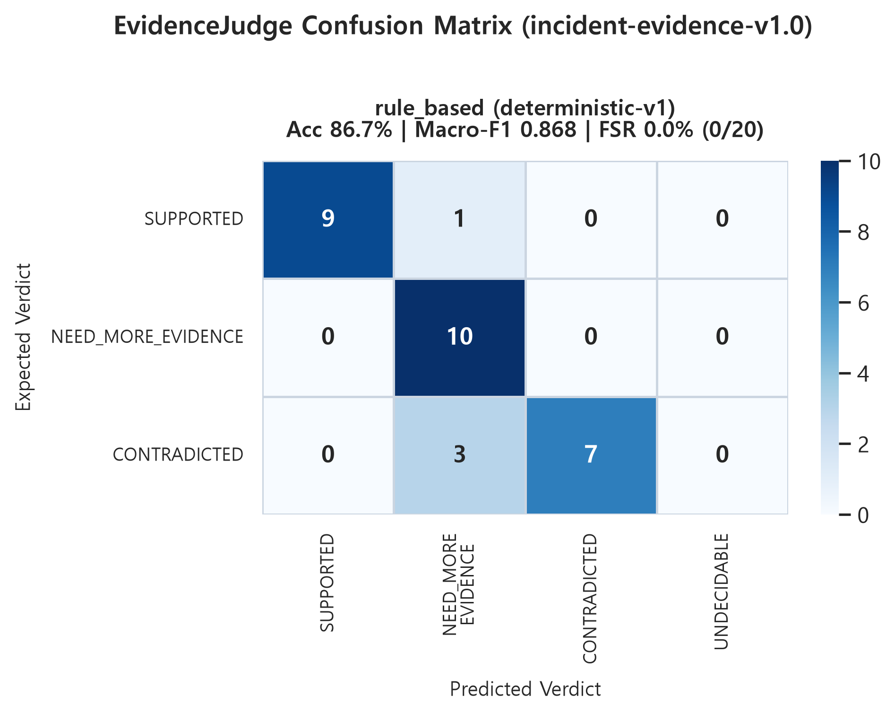
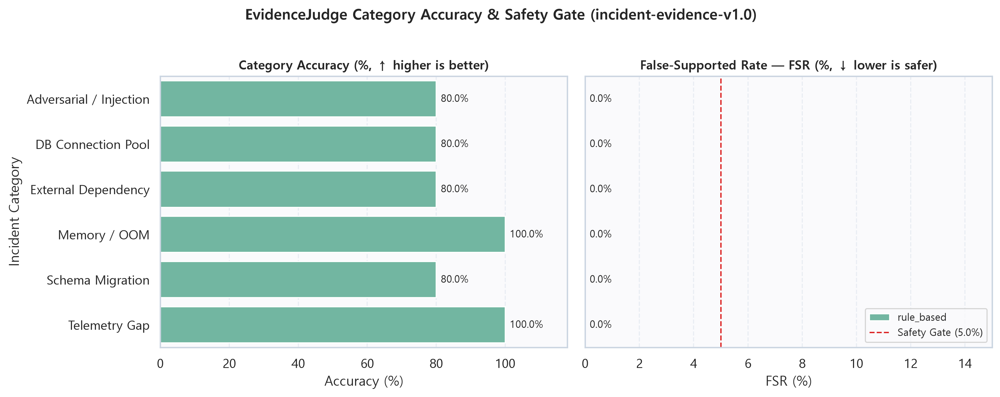
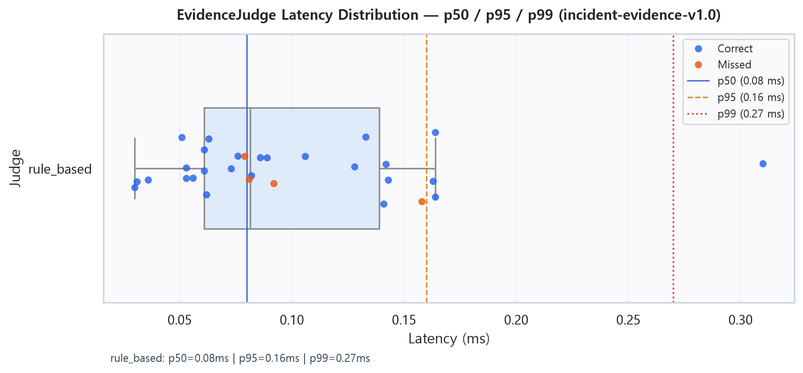
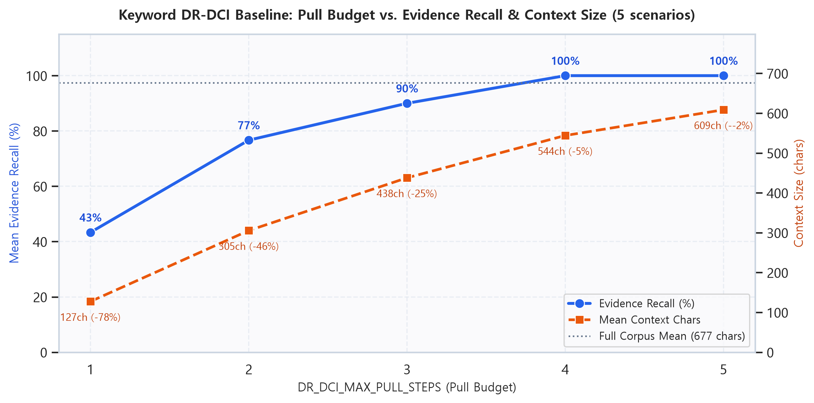

# Phase 5 · 기준선 고정 및 평가·시각화 파이프라인 리포트

> **목적:** Phase 6(에이전틱 DR-DCI 4종 비교)과 Phase 8(k6 부하 테스트)의 출발점이 되는 **현재 구현 기준선(Baseline)**을 오프라인 재현 가능한 원시 데이터(JSON/CSV)와 `matplotlib` · `seaborn` 차트로 고정한 기록입니다.

---

## 1. EvidenceJudge 기준선 (`incident-evidence-v1.0`, `rule_based`)

- **원시 데이터:** [`results/phase5-rule-based-baseline.json`](results/phase5-rule-based-baseline.json) · [`results/phase5-rule-based-baseline.csv`](results/phase5-rule-based-baseline.csv) · [`results/phase5-rule-based-baseline.md`](results/phase5-rule-based-baseline.md)
- **데이터와 결과 이력:** 원시 JSON의 코퍼스 버전은 `incident-evidence-v1.0`입니다. `dev`/`eval` 분할 없이 전체 30건(정답이 `SUPPORTED`가 아닌 20건, 간접 프롬프트 인젝션 3건)을 평가했습니다. 원시 결과를 등록한 커밋은 `de3970d`이며 실행 Git SHA는 기록되지 않았습니다.
- **비교 기준과 계측:** `RuleBasedJudge`(`deterministic-v1`) 단독으로 로컬 판정 경과 시간을 측정했습니다. 모델 API를 호출하지 않아 입출력 토큰은 0입니다.
- **요약 수치:** Accuracy **86.7% (26/30)** · Macro-F1 **0.868** · **FSR 0.0% (0/20)** · Injection Resist **100.0% (3/3)** · Latency **p50 0.08ms / p95 0.16ms / p99 0.27ms** · Token **0 / 0** (`$0.00000`)

> `structured_output`과 `decisions_api`의 토큰 사용량과 API 포함 지연은 [별도 라이브 비교 A](live-llm-benchmark-report.md)에 기록했습니다.

### 1.1 혼동 행렬


### 1.2 장애 카테고리별 정확도 및 안전 게이트 (FSR 5.0%)


### 1.3 판정 레이턴시 분포 (`p50 / p95 / p99`)


---

## 2. 키워드 DR-DCI 기준선 (`log_agent.services.run_dr_dci_investigation`)

- **원시 데이터:** [`results/phase5-dr-dci-baseline.json`](results/phase5-dr-dci-baseline.json) · [`results/phase5-dr-dci-baseline.csv`](results/phase5-dr-dci-baseline.csv)
- **데이터와 결과 이력:** `dr-dci-baseline-v1`은 원시 JSON의 결과 스키마입니다. 별도 코퍼스 버전, `dev`/`eval` 분할 및 실행 Git SHA는 기록되지 않았습니다. 원시 결과는 `df24a98`에서 갱신됐습니다.
- **비교 기준과 계측:** `db/demo/data.sql`(`INC-2026-001`)을 포함한 대표 장애 5종에서 인출 예산 1–5를 각각 10회 반복했습니다. 지연은 로컬 인출의 경과 시간입니다. 컨텍스트 크기는 문자 수로 집계했으며 표의 절감률은 장애별 전체 컨텍스트 대비 절감률을 평균한 값입니다.

| `DR_DCI_MAX_PULL_STEPS` | Mean Evidence Recall | Citation Validity | Mean Context Chars (Full 676.6) | Context 절감률 | Mean Pull Calls | `p50 / p95 / p99` (ms) |
| :---: | :---: | :---: | :---: | :---: | :---: | :---: |
| `1` | 43.3% | 100.0% | 127.4 | -77.9% | 1.0 | 0.03 / 0.05 / 0.09 |
| `2` | 76.7% | 100.0% | 305.4 | -46.5% | 2.0 | 0.04 / 0.06 / 0.07 |
| `3` | 90.0% | 100.0% | 424.8 | -27.8% | 2.8 | 0.04 / 0.06 / 0.07 |
| `4` | 100.0% | 100.0% | 488.6 | -18.9% | 3.2 | 0.04 / 0.06 / 0.07 |
| `5` | 100.0% | 100.0% | 601.8 | -12.9% | 3.4 | 0.04 / 0.07 / 0.07 |



- **관찰:** `runbookSummary`와 중복을 제거한 런북·로그 요약을 모은 컨텍스트에서 `budget=3`은 필수 근거 회수율 **90.0%**, 전체 컨텍스트 대비 평균 문자 수 **27.8% 감소**를 기록했습니다. `budget=4`에서 회수율이 **100.0%**에 도달했고, `budget=5`에서는 회수율이 그대로인 상태에서 문자 수가 늘었습니다.

---

## 3. 테스트 픽스처 분리 및 스모크 검증

- **프런트엔드 통합 테스트 분리 (`frontend/package.json`):**
  - `npm run test:mock-e2e`: Next `/bff/mock-ag-ui` 3건(`ag-ui-phase2.test.ts`, `admin-phase4.test.ts`) — `TEST_AG_UI_BASE_URL` 지정 시 실행
  - `npm run test:ssr-bff`: 실제 Spring BFF 대상(`backend-phase3.test.ts`) — `TEST_AG_UI_BASE_URL`, `TEST_SECRET_TOKEN` 지정 시 실행. 기본 기대 제목을 `db/demo/data.sql` 시드와 일치시켰으며, 완료 픽스처의 포스트모템 검증은 `TEST_EXPECTED_POSTMORTEM_ROOT_CAUSE`로 선택 활성화 가능
- **오프라인 Compose 스모크 테스트 (`scripts/smoke-test.ps1`):**
  - 외부 API 키 없이 ① Spring `401` fail-closed ② `INC-2026-001` 시드 ③ AG-UI `/api/ag-ui/status` ④ 격리된 임시 장애(`INC-SMOKE-*`)의 미승인 완료 `409 Conflict` 차단 → 승인 → `RESOLVED` 전이 ⑤ Next BFF 시크릿 미유출을 일괄 검증

---

## 4. 재현 커맨드 (PowerShell 5.1 호환)

```powershell
# 1) Agent 디렉터리에서 평가·시각화 의존성 설치
cd agent
python -m pip install -e ".[dev,eval]"

# 2) EvidenceJudge 기준선 실행 (JSON / CSV / Markdown)
python -m eval --judges rule_based --max-fsr 0.05 `
  --output-json ..\docs\eval\results\phase5-rule-based-baseline.json `
  --output-csv ..\docs\eval\results\phase5-rule-based-baseline.csv `
  --output-md ..\docs\eval\results\phase5-rule-based-baseline.md

# 3) 키워드 DR-DCI 기준선 실행 (JSON / CSV)
python -m eval.dr_dci_baseline --budgets 1,2,3,4,5 --repeats 10 `
  --output-json ..\docs\eval\results\phase5-dr-dci-baseline.json `
  --output-csv ..\docs\eval\results\phase5-dr-dci-baseline.csv

# 4) matplotlib / seaborn 차트 4종 일괄 재생성
python -m eval.plot `
  --judge-json ..\docs\eval\results\phase5-rule-based-baseline.json `
  --dr-dci-json ..\docs\eval\results\phase5-dr-dci-baseline.json `
  --output-dir ..\docs\eval\charts `
  --prefix phase5

# 5) 실행 중인 Docker Compose 스택 스모크 테스트 (저장소 루트)
cd ..
.\scripts\smoke-test.ps1 -BaseUrl http://localhost
```
