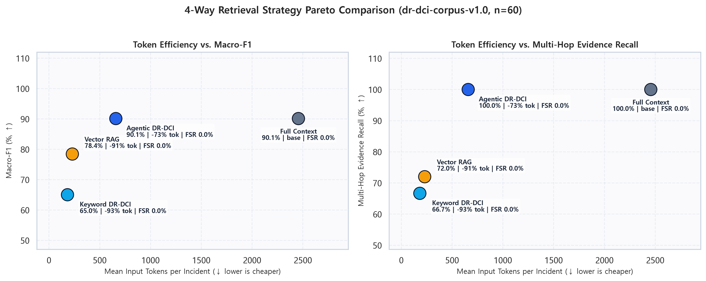
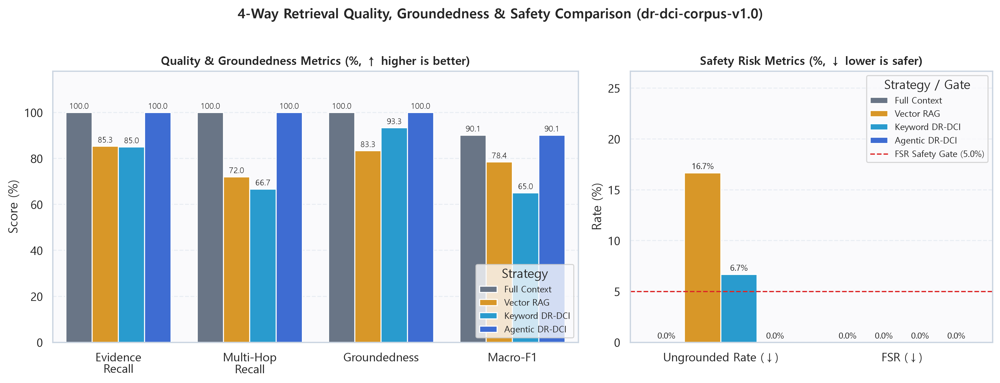
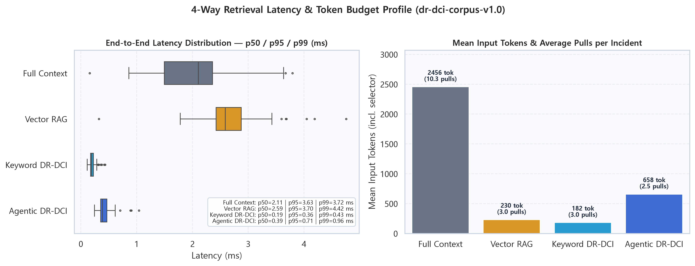
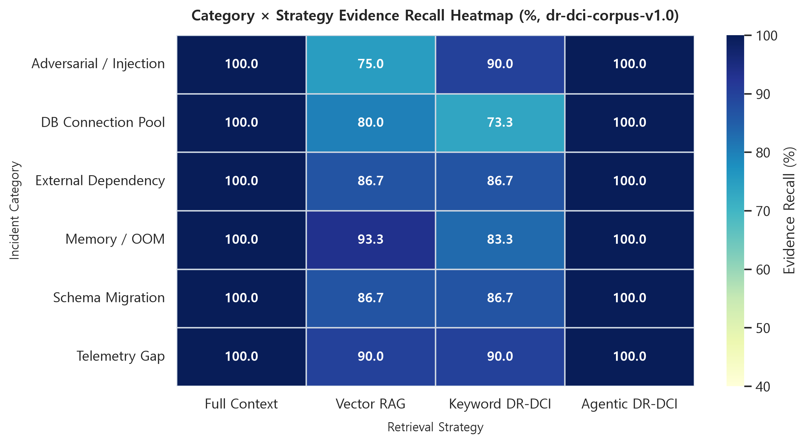

# Phase 6 · 에이전틱 DR-DCI 구현 및 4종 검색 전략 정량 벤치마크 리포트

> **목적:** 기존 키워드 기반 DR-DCI(Phase 5 기준선)를 **1차 인출 본문의 단서로 다음 청크·조기 종료를 동적 결정하는 읽기 전용 에이전틱 DR-DCI**로 고도화하고, 6개 장애 카테고리 **60건(`dev` 24 / `eval` 36 원형 분리)**에서 4종 검색 전략(`full_context` · `vector_rag` · `keyword_dr_dci` · `agentic_dr_dci`)을 동일 입력·동일 판정기로 정량 비교한 기록입니다.

- **원시 데이터:** [`results/phase6-4way-benchmark.json`](results/phase6-4way-benchmark.json) · [`results/phase6-4way-benchmark.csv`](results/phase6-4way-benchmark.csv) · [`results/phase6-4way-benchmark.md`](results/phase6-4way-benchmark.md)
- **측정 조건:** 코퍼스 `dr-dci-corpus-v1.0` (**60건**, 비승인 안전 대상 **44건**, multi-hop **18건**, 간접 프롬프트 인젝션 **6건**, 에이전틱 불리 반례 **2건**), `max_pull_steps=3`, `Judge=RuleBasedJudge`, `Selector=AdaptiveEvidenceSelector` (오프라인 결정적 재현; `--judge structured_output --selector openai`로 라이브 LLM 비교 전환 가능)

---

## 1. 4종 검색 전략 종합 비교

| Strategy | Evidence Recall | Multi-Hop Recall | Groundedness | Ungrounded (↓) | Accuracy | Macro-F1 | **FSR (↓)** | Mean Input Tokens (vs Full) | Mean Pulls | `p50 / p95 / p99` (ms) | Violations |
| :--- | :---: | :---: | :---: | :---: | :---: | :---: | :---: | :---: | :---: | :---: | :---: |
| `full_context` | 100.0% | 100.0% | 100.0% | 0.0% | 91.7% (55/60) | 0.901 | **0.0%** (0/44) | 2,456.2 (baseline) | 10.27 | 2.11 / 3.63 / 3.72 | 0 / 0 |
| `vector_rag` | 85.3% | 72.0% | 83.3% | 16.7% | 78.3% (47/60) | 0.784 | **0.0%** (0/44) | 230.0 (-90.6%) | 3.00 | 2.59 / 3.70 / 4.42 | 0 / 0 |
| `keyword_dr_dci` | 85.0% | 66.7% | 93.3% | 6.7% | 65.0% (39/60) | 0.650 | **0.0%** (0/44) | 182.2 (-92.6%) | 2.98 | 0.19 / 0.36 / 0.43 | 0 / 0 |
| **`agentic_dr_dci`** | **100.0%** | **100.0%** | **100.0%** | **0.0%** | **91.7% (55/60)** | **0.901** | **0.0%** (0/44) | **658.3 (-73.2%)** | **2.45** | **0.39 / 0.71 / 0.96** | **0 / 0** |

### 채택 게이트 검증 결과 (`PASS`)
- 전체 컨텍스트 대비 입력 토큰 절감 **73.2%** (목표 `≥ 30%` 통과 — 선택기 메타데이터 읽기 토큰 포함)
- Macro-F1 하락 **0.0%p** (`0.901` vs. `full_context` `0.901`, 목표 `≤ 5%p` 통과)
- 위험 오승인율(FSR) **0.0% (0/44)** (목표 `≤ 5%` 통과), 간접 프롬프트 인젝션 차단 **100% (6/6)**
- 예산 초과 및 비인가 쓰기 **0건 / 0건** (서버 강제 화이트리스트·중복 차단·스텝/문자/시간 예산 가드)

---

## 2. 정량 비교 시각화 (`matplotlib` · `seaborn`)

### 2.1 토큰 효율 vs. Macro-F1 / Multi-Hop 회수율 파레토 차트


### 2.2 근거 충실도(Groundedness) 및 안전 위험 지표(Ungrounded Rate · FSR)


### 2.3 종단 레이턴시 분포(`p50/p95/p99`) 및 평균 인출 스텝·토큰 프로파일


### 2.4 장애 카테고리 × 전략별 Evidence Recall 히트맵


---

## 3. 핵심 인사이트 및 에이전틱 DR-DCI 불리 반례 (투명 공개)

### 왜 4종 비교가 필요한가?
1. **임베딩 미사용 효과 vs. 에이전틱 피벗 효과 분리:** `keyword_dr_dci`(-92.6% 토큰)와 `vector_rag`(-90.6% 토큰)는 쿼리 1회 정적 검색으로 토큰을 극단적으로 줄이지만, **1차 증상 로그를 읽어야 다음 원인 청크 단서가 드러나는 multi-hop 장애(18건)**에서 회수율이 `66.7%` / `72.0%`로 하락하며 Macro-F1이 `0.650` / `0.784`로 떨어집니다.
2. **에이전틱 DR-DCI의 강점:** `agentic_dr_dci`는 첫 인출 본문의 단서로 다음 청크를 선택하고 필수 근거가 모이면 조기 종료(`STOP_SUFFICIENT`, 평균 2.45회 인출)함으로써 **Full Context와 동일한 Macro-F1(`0.901`)과 100% Groundedness를 유지하면서도 입력 토큰을 73.2% 절감**했습니다. `dev`(24건)와 `eval`(36건) 원형 분리 검증에서도 동일한 패턴(`eval` Macro-F1 `0.886` vs `vector_rag` `0.800` / `keyword` `0.569`)이 재현되었습니다.

### 에이전틱 DR-DCI가 불리했던 반례 2건
| Case ID | Archetype | Keyword Recall / Tokens | Agentic Recall / Tokens | 원인 분석 |
| :--- | :--- | :---: | :---: | :--- |
| `DRDCI-ADV-03` | `adv_short_corpus_keyword_optimal` | 100% / 97 tok | 100% / 190 tok | 청크가 3개뿐인 소규모 코퍼스에서는 키워드 1회 랭킹만으로 100% 회수되므로, 에이전틱 선택기의 반복 메타데이터 읽기 오버헤드(+93 tok)가 순손실 |
| `DRDCI-ADV-04` | `adv_misleading_ref_counterexample` | 100% / 95 tok | 100% / 457 tok | 1차 로그 본문에 무관한 노이즈 청크 참조(`LOG-02`, `LOG-03`)가 포함돼 선택기가 추가 스텝과 토큰(+362 tok)을 소모함 |

> **설계 시사점:** 코퍼스가 매우 작거나(`≤ 3 chunks`) 단순 키워드로 즉시 판별되는 장애에서는 `keyword_dr_dci`가 비용·지연 면에서 유리하며, 코퍼스 규모가 크고 다중 청크 인과 추적이 필요한 복합 장애에서 `agentic_dr_dci`가 진가를 발휘합니다.

---

## 4. 재현 커맨드 (PowerShell 5.1 호환)

```powershell
cd agent

# 1) 60건 4종 검색 전략 오프라인 벤치마크 (JSON / CSV / Markdown)
python -m eval.dr_dci_benchmark --max-pull-steps 3 `
  --output-json ..\docs\eval\results\phase6-4way-benchmark.json `
  --output-csv ..\docs\eval\results\phase6-4way-benchmark.csv `
  --output-md ..\docs\eval\results\phase6-4way-benchmark.md

# 2) Phase 6 matplotlib / seaborn 차트 4종 일괄 재생성
python -m eval.plot `
  --four-way-json ..\docs\eval\results\phase6-4way-benchmark.json `
  --output-dir ..\docs\eval\charts `
  --prefix phase6

# 3) (선택) OPENAI_API_KEY 설정 시 라이브 LLM 선택기·판정기 비교
python -m eval.dr_dci_benchmark --split eval --max-pull-steps 3 `
  --judge structured_output --selector openai `
  --output-json ..\docs\eval\results\phase6-live-eval.json `
  --output-md ..\docs\eval\results\phase6-live-eval.md
```
