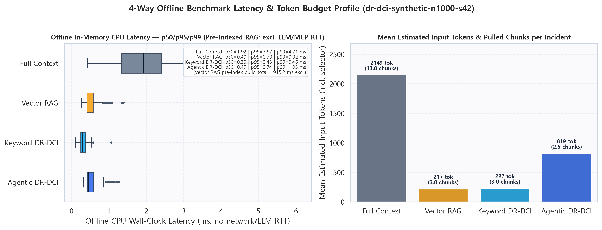
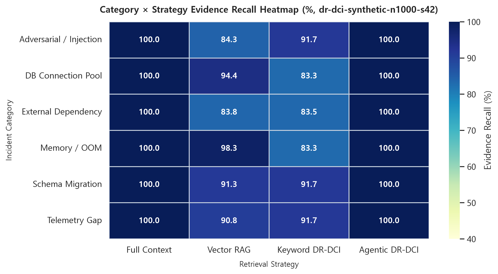

# Phase 6 확장 · 대규모 합성 장애 코퍼스(1,000건 · 13,007청크) 스케일 벤치마크 & k6 SQL 시드

> 합성 장애 1,000건, 총 13,007청크에서 4종 검색 전략을 오프라인으로 비교했습니다. 같은 생성기는 MySQL 8.0에 적재할 수 있는 k6 부하 테스트용 벌크 시드 SQL도 출력합니다.

- **원시 요약 데이터:** [`results/phase6-scale-1000-summary.json`](results/phase6-scale-1000-summary.json) · [`results/phase6-scale-1000-benchmark.md`](results/phase6-scale-1000-benchmark.md)
- **데이터와 결과 이력:** 원시 JSON의 코퍼스 버전은 `dr-dci-synthetic-n1000-s42`이며 `split_summaries`에 `dev` 462건, `eval` 538건이 기록됩니다. 원시 결과를 등록한 커밋은 `db0f3f0`이며 실행 Git SHA는 기록되지 않았습니다.
- **비교군:** 전체 청크 제공(`full_context`), 단어·문자 3-gram TF-IDF 코사인 Top-3(`vector_rag`), 키워드 순위 기반 인출(`keyword_dr_dci`), 본문 단서에 따라 다음 청크를 고르는 규칙 기반 선택기(`agentic_dr_dci`)를 같은 `RuleBasedJudge`로 평가했습니다.
- **계측:** 입력 토큰은 문자 수 기반 추정치입니다. 지연은 인메모리 검색과 규칙 판정의 로컬 경과 시간이며 API·MCP 왕복 시간과 k6 부하는 계측 범위 밖입니다. 이 보존 결과의 TF-IDF 지연에는 사례별 인덱스 준비가 포함됩니다.

---

## 1. 1,000건 오프라인 비교 결과 (`max_pull_steps=3`)

| Strategy | Evidence Recall | Multi-Hop Recall | Groundedness | Ungrounded (↓) | Accuracy | Macro-F1 | **FSR (↓)** | 평균 추정 입력 토큰 (vs Full) | Mean Pulls | 로컬 `p50 / p95 / p99` (ms) | 인출 초과 / 쓰기 고정값 |
| :--- | :---: | :---: | :---: | :---: | :---: | :---: | :---: | :---: | :---: | :---: | :---: |
| `full_context` | 100.0% | 100.0% | 100.0% | 0.0% | 88.3% (883/1000) | 0.873 | **0.0%** (0/652) | 2,146.0 (baseline) | 13.01 | 1.94 / 3.40 / 4.04 | 0 / 0 |
| `vector_rag` | 90.8% | 81.0% | 91.5% | 8.5% | 76.8% (768/1000) | 0.773 | **0.0%** (0/652) | 214.8 (-90.0%) | 3.00 | 2.33 / 3.74 / 5.14 | 0 / 0 |
| `keyword_dr_dci` | 84.6% | 66.7% | 92.2% | 7.8% | 65.3% (653/1000) | 0.662 | **0.0%** (0/652) | 168.6 (-92.1%) | 2.96 | 0.22 / 0.44 / 0.66 | 0 / 0 |
| **`agentic_dr_dci`** | **100.0%** | **100.0%** | **100.0%** | **0.0%** | **88.3% (883/1000)** | **0.873** | **0.0%** (0/652) | **814.4 (-62.1%)** | **2.46** | **0.46 / 0.97 / 1.30** | **0 / 0** |

- **오프라인 채택 게이트 `PASS`:** 추정 입력 62.1% 감소, Macro-F1 0.873 유지, FSR 0/652, 인출 횟수 초과 0건입니다. 원시 결과의 비인가 쓰기 카운터는 읽기 전용 러너에서 0으로 고정됩니다.
- **분할별 결과:** `eval` 538건에서 Macro-F1은 에이전틱 0.895, TF-IDF 0.731, 키워드 0.491이었습니다. 각 수치는 해당 생성 코퍼스에서 관측한 값입니다.

---

## 2. 1,000건 스케일 시각화 (`matplotlib` · `seaborn`)





---

## 3. 재현 및 수천 건 확장 / MySQL·k6 시드 생성 커맨드 (PowerShell 5.1)

아래 명령은 현재 체크아웃의 코드로 새 결과를 생성합니다. `--seed 42`는 동일한 생성기 버전과 옵션에서 합성 입력을 고정합니다.

```powershell
cd agent

# 1) 1,000건(13,007청크) JSONL + MySQL 8.0 벌크 시드 SQL + 4종 벤치마크 동시 실행
python -m eval.synthetic_generator `
  --count 1000 --seed 42 --noise-chunks 10 `
  --output-jsonl ..\loadtest\seeds\synthetic-1000.jsonl `
  --output-sql ..\loadtest\seeds\synthetic-1000-seed.sql `
  --run-benchmark --max-pull-steps 3 `
  --benchmark-summary-json ..\docs\eval\results\phase6-scale-1000-summary.json `
  --benchmark-md ..\docs\eval\results\phase6-scale-1000-benchmark.md

# 2) 3,000건(~39,000청크) k6 부하 테스트 전용 MySQL SQL 시드 생성 (벤치마크 생략)
python -m eval.synthetic_generator `
  --count 3000 --seed 42 --noise-chunks 10 `
  --output-sql ..\loadtest\seeds\synthetic-3000-seed.sql

# 3) Docker MySQL 컨테이너에 벌크 시드 적재 (Flyway V1~V7 대상)
Get-Content ..\loadtest\seeds\synthetic-1000-seed.sql -Raw | `
  docker exec -i incident-ops-mysql mysql -uops_user -pops_password_1234 incident_ops

# 4) 1,000건 스케일 차트 4종 재생성
python -m eval.plot `
  --four-way-json ..\docs\eval\results\phase6-scale-1000-summary.json `
  --output-dir ..\docs\eval\charts `
  --prefix phase6-scale-1000
```
