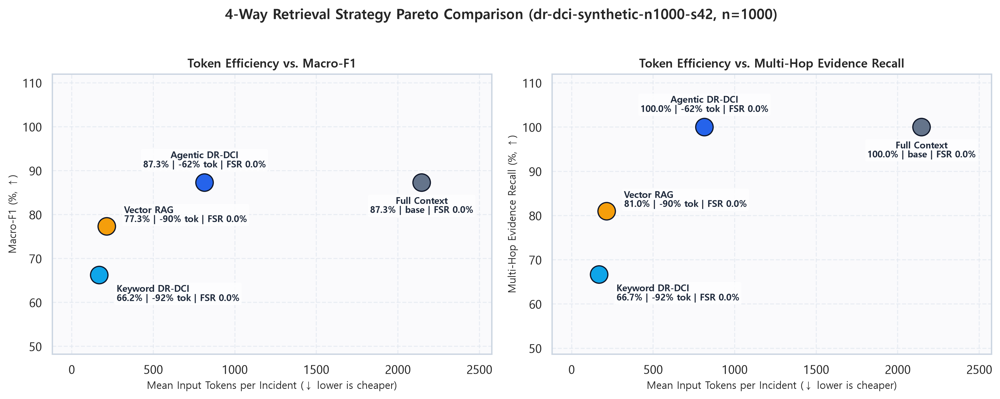

# Phase 6 확장 · 대규모 합성 장애 코퍼스(1,000건 · 13,007청크) 스케일 벤치마크 & k6 SQL 시드

> **목적:** 시드 기반 결정적 합성 장애 생성기(`agent/src/eval/synthetic_generator.py`)로 **1,000건(총 13,007개 코퍼스 청크, 30개 마이크로서비스, 26개 장애 원형, `dev` 462 / `eval` 538 원형 분리)**을 생성해 4종 검색 전략의 대규모 확장성과 일관성을 검증하고, Phase 8 k6 부하 테스트용 MySQL 8.0 벌크 시드 SQL을 즉시 생성할 수 있는 기반을 마련했습니다.

- **원시 요약 데이터:** [`results/phase6-scale-1000-summary.json`](results/phase6-scale-1000-summary.json) · [`results/phase6-scale-1000-benchmark.md`](results/phase6-scale-1000-benchmark.md)
- **대용량 원시 파일(JSONL / SQL) 관리 원칙:** 수 MB~수십 MB의 원시 코퍼스·SQL 파일은 저장소 비대화를 막기 위해 Git에 직접 커밋하지 않고, 아래 단일 CLI(`--seed 42`)로 언제든 바이트 단위로 동일하게 재현합니다.

---

## 1. 1,000건(13,007청크) 4종 검색 전략 실측 결과 (`max_pull_steps=3`)

| Strategy | Evidence Recall | Multi-Hop Recall | Groundedness | Ungrounded (↓) | Accuracy | Macro-F1 | **FSR (↓)** | Mean Input Tokens (vs Full) | Mean Pulls | `p50 / p95 / p99` (ms) | Violations |
| :--- | :---: | :---: | :---: | :---: | :---: | :---: | :---: | :---: | :---: | :---: | :---: |
| `full_context` | 100.0% | 100.0% | 100.0% | 0.0% | 88.3% (883/1000) | 0.873 | **0.0%** (0/652) | 2,146.0 (baseline) | 13.01 | 1.94 / 3.40 / 4.04 | 0 / 0 |
| `vector_rag` | 90.8% | 81.0% | 91.5% | 8.5% | 76.8% (768/1000) | 0.773 | **0.0%** (0/652) | 214.8 (-90.0%) | 3.00 | 2.33 / 3.74 / 5.14 | 0 / 0 |
| `keyword_dr_dci` | 84.6% | 66.7% | 92.2% | 7.8% | 65.3% (653/1000) | 0.662 | **0.0%** (0/652) | 168.6 (-92.1%) | 2.96 | 0.22 / 0.44 / 0.66 | 0 / 0 |
| **`agentic_dr_dci`** | **100.0%** | **100.0%** | **100.0%** | **0.0%** | **88.3% (883/1000)** | **0.873** | **0.0%** (0/652) | **814.4 (-62.1%)** | **2.46** | **0.46 / 0.97 / 1.30** | **0 / 0** |

- **채택 게이트 (`PASS`):** 1,000건 규모에서도 **입력 토큰 -62.1%**, **Macro-F1 하락 0.0%p**(`0.873`), **FSR 0.0% (0/652)**, **예산·권한 위반 0/0** 유지.
- **Dev / Eval 원형 분리 일관성:** `eval`(538건)에서 `agentic_dr_dci`는 Macro-F1 **0.895**로 `vector_rag`(0.731, +16.4%p)와 `keyword_dr_dci`(0.491, +40.4%p) 대비 격차가 60건 실험과 동일하게 유지되었습니다.

---

## 2. 1,000건 스케일 시각화 (`matplotlib` · `seaborn`)




---

## 3. 재현 및 수천 건 확장 / MySQL·k6 시드 생성 커맨드 (PowerShell 5.1)

```powershell
cd agent

# 1) 1,000건(13,007청크) JSONL + MySQL 8.0 벌크 시드 SQL + 4종 벤치마크 동시 실행
python -m eval.synthetic_generator `
  --count 1000 --seed 42 --noise-chunks 10 `
  --output-jsonl ..\loadtest\seeds\synthetic-1000.jsonl `
  --output-sql ..\loadtest\seeds\synthetic-1000-seed.sql `
  --run-benchmark --max-pull-steps 3 `
  --benchmark-summary-json ..\docs\eval\results\phase6-scale-1000-summary.json `
  --benchmark-md ..\docs\eval\results\phase6-scale-1000-benchmark.md

# 2) 3,000건(~39,000청크) k6 부하 테스트 전용 MySQL SQL 시드 생성 (벤치마크 생략)
python -m eval.synthetic_generator `
  --count 3000 --seed 42 --noise-chunks 10 `
  --output-sql ..\loadtest\seeds\synthetic-3000-seed.sql

# 3) Docker MySQL 컨테이너에 벌크 시드 적재 (Flyway V1~V7 스키마 100% 호환, 멱등)
Get-Content ..\loadtest\seeds\synthetic-1000-seed.sql -Raw | `
  docker exec -i incident-ops-mysql mysql -uops_user -pops_password_1234 incident_ops

# 4) 1,000건 스케일 차트 4종 재생성
python -m eval.plot `
  --four-way-json ..\docs\eval\results\phase6-scale-1000-summary.json `
  --output-dir ..\docs\eval\charts `
  --prefix phase6-scale-1000
```
