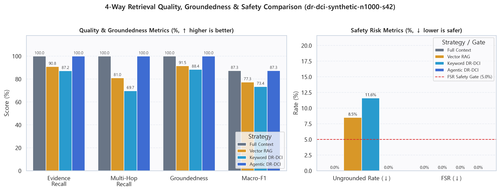

# Phase 6 확장 · 대규모 합성 장애 코퍼스(1,000건 · 13,007청크) 및 선형 스케일(`N = 10 → 500`) 벤치마크 & k6 SQL 시드

> 합성 장애 1,000건(총 13,007청크) 오프라인 4종 비교와 장애당 청크 수 선형 확장(`N = 10 → 500`) 4대 검색 패러다임 재측정 결과, 그리고 MySQL 8.0 k6 부하 테스트용 정규화 시드 SQL 생성 결과를 정리합니다.

- **원시 데이터 (1,000건 4종 비교):** [`results/phase6-scale-1000-summary.json`](results/phase6-scale-1000-summary.json) · [`results/phase6-scale-1000-benchmark.md`](results/phase6-scale-1000-benchmark.md)
- **원시 데이터 (선형 스케일 4대 패러다임):** [`results/scaling-4paradigm.json`](results/scaling-4paradigm.json) · [`results/scaling-4paradigm.csv`](results/scaling-4paradigm.csv) · [`results/scaling-4paradigm.md`](results/scaling-4paradigm.md) (세부 리포트: [`scaling-4paradigm-report.md`](scaling-4paradigm-report.md))
- **데이터 무결성 및 분할:** 코퍼스 버전은 `dr-dci-synthetic-n1000-s42`(`dev` 462건, `eval` 538건)입니다. `db_leak_2hop_eval`을 고유 배치 트랜잭션 데드락/장기 락 원형으로 완전히 분리해 `dev`와 `eval` 간 `archetype`/`template_id`뿐 아니라 정규화한 로그·런북의 제목과 본문이 각각 `dev`/`eval`에 겹치지 않는지 회귀 테스트로 검증합니다(양쪽에 공통으로 넣는 운영 노이즈 로그와 HPA 오답 런북은 제외).
- **계측 범위 (오프라인 전용):** 아래 두 실험 모두 `RuleBasedJudge`와 인메모리 코퍼스를 사용한 **오프라인 CPU 벤치마크**(`offline_in_memory_preindexed_no_llm_mcp_rtt`)입니다. 정적 검색의 TF-IDF/BM25 인덱스는 쿼리 타이머 바깥에서 사전 구축했으며, 실제 OpenAI API·MCP 네트워크 왕복 시간 및 Docker MySQL/k6 실부하는 계측 범위 밖입니다(실제 LLM API 측정은 [`live-llm-benchmark-report.md`](live-llm-benchmark-report.md) 참고).

---

## 1. 1,000건 합성 코퍼스 4종 검색 전략 비교 (`max_pull_steps=3`)

| Strategy | Evidence Recall | Multi-Hop Recall | Groundedness | Ungrounded (↓) | Accuracy | Macro-F1 | **FSR (↓)** | 평균 추정 입력 토큰 (vs Full) | Mean Pulls | 로컬 `p50 / p95 / p99` (ms) | 인출 초과 / 쓰기 고정값 |
| :--- | :---: | :---: | :---: | :---: | :---: | :---: | :---: | :---: | :---: | :---: | :---: |
| `full_context` | 100.0% | 100.0% | 100.0% | 0.0% | 88.3% (883/1000) | 0.873 | **0.0%** (0/652) | 2,148.7 (baseline) | 13.01 | 1.92 / 3.57 / 4.71 | 0 / 0 |
| `vector_rag` *(pre-indexed)* | 90.8% | 81.0% | 91.5% | 8.5% | 76.8% (768/1000) | 0.773 | **0.0%** (0/652) | 216.7 (-89.9%) | 3.00 | 0.49 / 0.70 / 0.92 | 0 / 0 |
| `keyword_dr_dci` | 87.2% | 69.7% | 88.4% | 11.6% | 73.0% (730/1000) | 0.734 | **0.0%** (0/652) | 227.0 (-89.4%) | 3.00 | **0.30 / 0.43 / 0.46** | 0 / 0 |
| **`agentic_dr_dci`** | **100.0%** | **100.0%** | **100.0%** | **0.0%** | **88.3% (883/1000)** | **0.873** | **0.0%** (0/652) | **819.2 (-61.9%)** | **2.46** | 0.47 / 0.74 / 1.03 | **0 / 0** |

- **오프라인 채택 게이트 `PASS`:** 추정 입력 토큰 **61.9% 감소**(목표 `≥ 30%`), Macro-F1 **0.873 유지**(하락 0.0%p), **FSR 0.0% (0/652)**, 인출 예산 초과 0건. 비인가 쓰기 카운터는 읽기 전용 러너에서 0으로 고정됩니다.
- **분할별 결과:** `eval` 538건에서 Macro-F1은 `agentic_dr_dci` **0.895**, `vector_rag` 0.731, `keyword_dr_dci` 0.613이었습니다(`dev` 462건은 세 전략 모두 0.848). `keyword_dr_dci`는 색인 확장 조건을 고친 `1de528c` 코드의 결과입니다.





---

## 2. 선형 데이터 증가(`N = 10 → 500`) 4대 패러다임 재측정 (`scaling-4paradigm.json`)

> `_IndexedWindowSelector._prefilter_index`에서 Hard Distractor 템플릿에만 매칭되던 키워드 감점(`-6`) 편향을 완전히 제거하고, `seed=42`, `incidents_per_scale=30`, `top_k=3`, 25% Hard Distractor + 75% 운영 노이즈, 단일 요청 최대 입력 `32,000`토큰 한도 기준으로 재측정한 결과입니다.

| Chunks / Incident (`N`) | Paradigm | Evidence Recall | Multi-Hop Recall | Groundedness | Macro-F1 | FSR | Mean Input Tokens (vs DCI) | >32k Overflow | 로컬 `p50 / p95 / p99` (ms) |
| :---: | :--- | :---: | :---: | :---: | :---: | :---: | :---: | :---: | :---: |
| `10` | `native_rag` | 73.3% | 61.9% | 90.0% | 0.644 | 0.0% (0/18) | 266 (-79.1%) | 0% | 0.41 / 0.56 / 0.60 |
| `10` | `hybrid_rag_rrf` | 83.3% | 76.2% | 93.3% | 0.642 | 0.0% (0/18) | 236 (-81.4%) | 0% | 0.44 / 0.59 / 0.62 |
| `10` | `dci` | 100.0% | 100.0% | 100.0% | 0.789 | 0.0% (0/18) | 1,272 (baseline) | 0% | 1.05 / 1.71 / 1.78 |
| `10` | **`dr_dci`** | **100.0%** | **100.0%** | **100.0%** | **0.789** | **0.0% (0/18)** | **647 (-49.1%)** | **0%** | 0.46 / 0.86 / 0.95 |
| `50` | `native_rag` | 64.4% | 50.0% | 86.7% | 0.540 | 0.0% (0/18) | 290 (-96.0%) | 0% | 1.20 / 1.46 / 1.57 |
| `50` | `hybrid_rag_rrf` | 65.6% | 52.4% | 86.7% | 0.540 | 0.0% (0/18) | 287 (-96.1%) | 0% | 1.25 / 1.47 / 1.54 |
| `50` | `dci` | 100.0% | 100.0% | 100.0% | 0.789 | 0.0% (0/18) | 7,351 (baseline) | 0% | 6.13 / 9.34 / 9.69 |
| `50` | **`dr_dci`** | **96.1%** | **95.2%** | **96.7%** | **0.762** | **0.0% (0/18)** | **982 (-86.6%)** | **0%** | 0.99 / 1.69 / 1.76 |
| `100` | `native_rag` | 60.0% | 47.6% | 86.7% | 0.540 | 0.0% (0/18) | 302 (-98.0%) | 0% | 2.11 / 3.30 / 4.62 |
| `100` | `hybrid_rag_rrf` | 60.0% | 47.6% | 86.7% | 0.540 | 0.0% (0/18) | 302 (-98.0%) | 0% | 2.22 / 2.46 / 2.51 |
| `100` | `dci` | 100.0% | 100.0% | 100.0% | 0.789 | 0.0% (0/18) | 14,939 (baseline) | 0% | 12.64 / 18.52 / 19.11 |
| `100` | **`dr_dci`** | **92.2%** | **90.5%** | **96.7%** | **0.734** | **0.0% (0/18)** | **997 (-93.3%)** | **0%** | 1.52 / 2.27 / 2.90 |
| `200` | `native_rag` | 61.1% | 50.0% | 86.7% | 0.573 | 0.0% (0/18) | 299 (-99.0%) | 0% | 3.85 / 4.31 / 4.37 |
| `200` | `hybrid_rag_rrf` | 61.1% | 50.0% | 86.7% | 0.540 | 0.0% (0/18) | 298 (-99.0%) | 0% | 4.18 / 4.53 / 4.69 |
| `200` | `dci` | 100.0% | 100.0% | 100.0% | 0.789 | 0.0% (0/18) | 30,220 (baseline) | 0% | 25.13 / 36.78 / 37.68 |
| `200` | **`dr_dci`** | **86.7%** | **85.7%** | **93.3%** | **0.699** | **0.0% (0/18)** | **1,018 (-96.6%)** | **0%** | 2.41 / 3.78 / 4.48 |
| `300` | `native_rag` | 62.2% | 52.4% | 86.7% | 0.573 | 0.0% (0/18) | 295 (-99.4%) | 0% | 5.61 / 6.24 / 6.35 |
| `300` | `hybrid_rag_rrf` | 61.1% | 50.0% | 86.7% | 0.540 | 0.0% (0/18) | 298 (-99.3%) | 0% | 6.31 / 6.80 / 6.91 |
| `300` | `dci` | 100.0% | 100.0% | 100.0% | 0.789 | 0.0% (0/18) | 45,540 (baseline) | **100%** | 38.48 / 61.27 / 64.72 |
| `300` | **`dr_dci`** | **80.0%** | **71.4%** | **86.7%** | **0.706** | **0.0% (0/18)** | **1,049 (-97.7%)** | **0%** | 3.03 / 3.51 / 3.67 |
| `500` | `native_rag` | 63.3% | 54.8% | 86.7% | 0.573 | 0.0% (0/18) | 292 (-99.6%) | 0% | 9.19 / 10.03 / 10.62 |
| `500` | `hybrid_rag_rrf` | 62.2% | 52.4% | 86.7% | 0.540 | 0.0% (0/18) | 295 (-99.6%) | 0% | 10.39 / 12.29 / 12.91 |
| `500` | `dci` | 100.0% | 100.0% | 100.0% | 0.789 | 0.0% (0/18) | 76,161 (baseline) | **100%** | 64.20 / 96.16 / 111.62 |
| `500` | **`dr_dci`** | **74.4%** | **66.7%** | **86.7%** | **0.671** | **0.0% (0/18)** | **1,062 (-98.6%)** | **0%** | 4.58 / 5.07 / 8.57 |

- **핵심 해석:**
  1. 기본 설정의 `dr_dci`는 distractor 전용 감점을 제거한 뒤에도 `N=10 → 500` 전 구간에서 `native_rag`·`hybrid_rag_rrf` 대비 더 높은 Evidence Recall·Multi-Hop Recall·Macro-F1을 유지하면서 `dci` 대비 입력 토큰을 **-49.1% → -98.6%** 절감하고 `>32k Overflow 0%`, `FSR 0.0%`를 기록했습니다. 다만 `N=500`에서 런북 색인 가산점이나 본문의 청크 ID 참조 중 하나만 없어도 Multi-Hop Recall은 `native_rag`보다 낮아집니다([영향 측정](scaling-4paradigm-report.md#5-dr-dci-설계-요소의-영향-multi-hop-recall--macro-f1)).
  2. 동시에 고정 12슬롯 색인 창(`index_window=12`)의 실제 한계도 투명하게 드러났습니다. 25% Hard Distractor가 `N=200 → 500`으로 누적되면 `dr_dci`의 Multi-Hop Recall이 `90.5% (N=100) → 85.7% (N=200) → 71.4% (N=300) → 66.7% (N=500)`으로, Macro-F1이 `0.734 → 0.671`로 점진 하락합니다.


---

## 3. 오프라인 코퍼스 vs. 실 MySQL 공용 런북 범위 정규화

실 MySQL 백엔드의 `CorpusMapper.xml`은 `corpus_type = 'RUNBOOK' AND incident_code IS NULL` 조건으로 **서비스 단위 공용 런북**을 조회합니다.

| 구분 | 장애 건수 | 로그 청크 (`LOG`) | 런북 청크 (`RUNBOOK`) | 총 `corpus_chunks` | 비고 |
| :--- | :---: | :---: | :---: | :---: | :--- |
| **오프라인 인메모리 코퍼스** (`synthetic-1000.jsonl`) | 1,000 | 11,121 | 1,886 (케이스별 격리 픽스처) | 13,007 | 사건별 독립 평가 시 케이스당 1~2개 런북 사용 |
| **실 MySQL 시드 SQL** (`write_mysql_seed_sql`) | 1,000 | 11,121 | **605 (`shared_runbook_count`)** | **11,726** | 서비스·제목·키워드·본문이 모두 같은 런북 1,281건만 합치고 `remediation_plans.evidenceChunkIds`를 매핑 |

- 내용이 다른 런북은 합치지 않으므로 각 계획의 근거는 원래 장애의 런북과 같습니다.
- **남는 차이:** 실 DB의 런북 검색은 서비스 공용이라 서비스당 14–26개(평균 약 20개)가 후보가 됩니다. 오프라인 평가는 장애별로 런북 1–2개만 후보로 삼으므로, 두 환경의 검색 품질·지연을 같은 조건으로 볼 수 없습니다.

---

## 4. 재현 및 MySQL·k6 시드 적재 커맨드 (PowerShell 5.1)

> **UTF-8 바이트 보존 주의:** Windows PowerShell 5.1에서 `Get-Content ... -Raw | docker exec ...` 텍스트 파이프는 시스템 코드페이지(CP949)로 재인코딩되어 한글 로그·런북이 깨질 수 있습니다. 아래처럼 `cmd /c "... < file.sql"` 리다이렉션과 `--default-character-set=utf8mb4`를 사용해 원본 UTF-8 바이트를 그대로 전달하세요.

```powershell
cd agent
$env:PYTHONPATH = "src"

# 1) 1,000건(오프라인 13,007청크 / MySQL 정규화 11,726청크, shared_runbook_count=605) + 4종 벤치마크
python -m eval.synthetic_generator `
  --count 1000 --seed 42 --noise-chunks 10 `
  --output-jsonl ..\loadtest\seeds\synthetic-1000.jsonl `
  --output-sql ..\loadtest\seeds\synthetic-1000-seed.sql `
  --run-benchmark --max-pull-steps 3 `
  --benchmark-summary-json ..\docs\eval\results\phase6-scale-1000-summary.json `
  --benchmark-md ..\docs\eval\results\phase6-scale-1000-benchmark.md

# 2) 선형 스케일(N=10..500) 4대 패러다임 벤치마크 및 차트 2종 재생성
python -m eval.scaling_benchmark `
  --scales 10,50,100,200,300,500 --incidents 30 --seed 42 --top-k 3 `
  --output-json ..\docs\eval\results\scaling-4paradigm.json `
  --output-csv ..\docs\eval\results\scaling-4paradigm.csv `
  --output-md ..\docs\eval\results\scaling-4paradigm.md

python -m eval.plot `
  --scaling-json ..\docs\eval\results\scaling-4paradigm.json `
  --output-dir ..\docs\eval\charts `
  --prefix scaling-4paradigm

# 3) Docker MySQL 컨테이너에 벌크 시드 적재. 빈 DB에 적재합니다(이전 시드가 남아 있으면 옛 런북·근거 ID가 함께 남습니다)
#     (UTF-8 바이트 보존. 2026-11-26 MySQL 8.0의 빈 스키마에 Flyway V1–V7 적용 후 적재해
#      장애 1,000 · 청크 11,726(로그 11,121, 공용 런북 605) · 계획 333건을 확인)
cmd /c "docker exec -i incident-ops-mysql mysql --default-character-set=utf8mb4 -uops_user -pops_password_1234 incident_ops < ..\loadtest\seeds\synthetic-1000-seed.sql"

# 4) 1,000건 스케일 차트 4종 재생성
python -m eval.plot `
  --four-way-json ..\docs\eval\results\phase6-scale-1000-summary.json `
  --output-dir ..\docs\eval\charts `
  --prefix phase6-scale-1000
```
