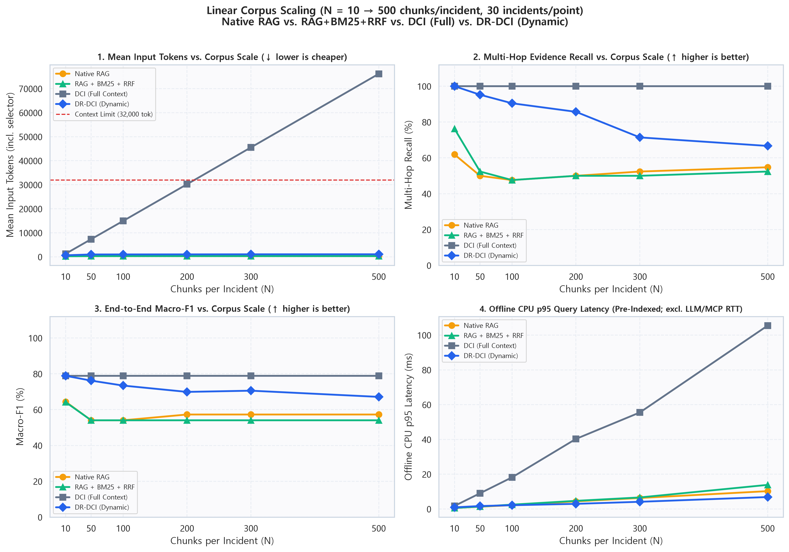
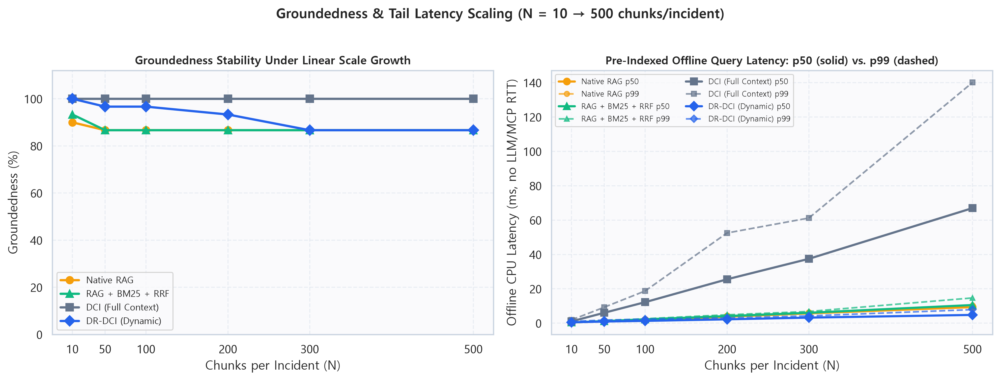

# 선형 데이터 증가(`N = 10 → 500`)에 따른 4대 검색 패러다임 성능 비교 리포트

> 장애당 청크 수를 10·50·100·200·300·500으로 바꿔, 4종 검색 전략의 근거 회수율·판정 품질·로컬 지연과 추정 입력 토큰을 공정 비교했습니다. 각 크기에서 `dev`/`eval` 템플릿이 완전히 분리된 합성 장애 30건을 확장해 사용했습니다.

- **원시 데이터:** [`results/scaling-4paradigm.json`](results/scaling-4paradigm.json) · [`results/scaling-4paradigm.csv`](results/scaling-4paradigm.csv) · [`results/scaling-4paradigm.md`](results/scaling-4paradigm.md)
- **데이터와 결과 이력:** 원시 JSON의 결과 스키마는 `linear-scaling-4paradigm-v1`입니다. `seed=42`, 크기별 30건, `top_k=3`, 25% Hard Distractor + 75% 운영 노이즈 구성으로 재실측했습니다. 기존 `_IndexedWindowSelector._prefilter_index`에 존재하던 distractor 전용 키워드 감점(`-6`) 편향을 제거하고 `db_leak_2hop_eval`을 고유 데드락 원형으로 분리한 공정 기준 수치입니다.
- **측정 단위:** 지연은 인메모리 검색과 `RuleBasedJudge`를 포함한 오프라인 로컬 경과 시간(`offline_in_memory_preindexed_no_llm_mcp_rtt`)입니다. 정적 검색 두 방식의 인덱스 준비는 타이머 밖에서 수행했습니다. 토큰은 문자 수 기반 추정이며 LLM API·MCP 왕복 시간은 이 실험에서 계측하지 않았습니다.
- **32,000토큰 기준:** 누적 합이 아니라 단일 모델 요청 최대 입력 토큰(`max_request_in_tok > 32,000`)을 기준으로 `>32k Overflow` 비율을 판정합니다.

| 전략 | 이 실험의 구현 |
| :--- | :--- |
| `Native RAG` | 사전 구축한 단어·문자 3-gram TF-IDF 벡터의 코사인 Top-3 |
| `RAG + BM25 + RRF` | TF-IDF 순위와 Okapi BM25 순위(`k1=1.5`, `b=0.75`)를 RRF(`k=60`)로 합친 Top-3 |
| `DCI (Full)` | 해당 장애의 모든 청크를 판정기에 제공 |
| `DR-DCI` | 색인 창(`index_window=12`, distractor 감점 없음) + `AdaptiveEvidenceSelector`가 인출 본문 단서로 다음 청크를 결정. 색인 정렬에는 런북 가산점(+18), 본문이 직접 참조한 청크(+100), 단서·키워드 일치 점수가 쓰이며 정적 검색 두 방식에는 없는 DR-DCI 설계 요소입니다 |

---

## 1. 4대 패러다임 스케일링 종합 대시보드 (2×2)



## 2. Groundedness 안정성 및 `p50 / p99` Tail Latency 스케일링



---

## 3. 오프라인 공정 재실측 결과 (`N = 10 → 500` 전 구간)

| Scale (`N`) | Paradigm | Evidence Recall | Multi-Hop Recall | Groundedness | Macro-F1 | FSR | 평균 추정 입력 토큰 (vs DCI) | 단일 요청 >32k | 로컬 `p50 / p95 / p99` (ms) |
| :---: | :--- | :---: | :---: | :---: | :---: | :---: | :---: | :---: | :---: |
| `10` | `native_rag` *(pre-indexed)* | 73.3% | 61.9% | 90.0% | 0.644 | 0.0% (0/18) | 266 (-79.1%) | 0% | **0.42 / 0.55 / 0.57** |
| `10` | `hybrid_rag_rrf` *(pre-indexed)* | 83.3% | 76.2% | 93.3% | 0.642 | 0.0% (0/18) | 236 (-81.5%) | 0% | 0.44 / 0.56 / 0.58 |
| `10` | `dci` | 100.0% | 100.0% | 100.0% | 0.789 | 0.0% (0/18) | 1,272 (baseline) | 0% | 1.06 / 1.76 / 1.91 |
| `10` | **`dr_dci`** | **100.0%** | **100.0%** | **100.0%** | **0.789** | **0.0% (0/18)** | **647 (-49.1%)** | **0%** | 0.51 / 0.93 / 1.05 |
| `50` | `native_rag` *(pre-indexed)* | 64.4% | 50.0% | 86.7% | 0.540 | 0.0% (0/18) | 290 (-96.1%) | 0% | 1.13 / 1.31 / 1.36 |
| `50` | `hybrid_rag_rrf` *(pre-indexed)* | 65.6% | 52.4% | 86.7% | 0.540 | 0.0% (0/18) | 287 (-96.1%) | 0% | 1.23 / 1.39 / 1.46 |
| `50` | `dci` | 100.0% | 100.0% | 100.0% | 0.789 | 0.0% (0/18) | 7,350 (baseline) | 0% | 6.07 / 9.04 / 9.29 |
| `50` | **`dr_dci`** | **96.1%** | **95.2%** | **96.7%** | **0.762** | **0.0% (0/18)** | **982 (-86.7%)** | **0%** | 0.97 / 1.69 / 1.79 |
| `100` | `native_rag` *(pre-indexed)* | 60.0% | 47.6% | 86.7% | 0.540 | 0.0% (0/18) | 302 (-98.0%) | 0% | 1.94 / 2.18 / 2.32 |
| `100` | `hybrid_rag_rrf` *(pre-indexed)* | 60.0% | 47.6% | 86.7% | 0.540 | 0.0% (0/18) | 301 (-98.0%) | 0% | 2.25 / 2.49 / 2.60 |
| `100` | `dci` | 100.0% | 100.0% | 100.0% | 0.789 | 0.0% (0/18) | 14,938 (baseline) | 0% | 12.24 / 18.19 / 18.77 |
| `100` | **`dr_dci`** | **92.2%** | **90.5%** | **96.7%** | **0.734** | **0.0% (0/18)** | **996 (-93.3%)** | **0%** | 1.34 / 2.15 / 2.35 |
| `200` | `native_rag` *(pre-indexed)* | 61.1% | 50.0% | 86.7% | 0.573 | 0.0% (0/18) | 298 (-99.0%) | 0% | 3.73 / 4.36 / 4.50 |
| `200` | `hybrid_rag_rrf` *(pre-indexed)* | 61.1% | 50.0% | 86.7% | 0.540 | 0.0% (0/18) | 298 (-99.0%) | 0% | 4.14 / 4.68 / 4.88 |
| `200` | `dci` | 100.0% | 100.0% | 100.0% | 0.789 | 0.0% (0/18) | 30,219 (baseline) | 0% | 25.54 / 40.29 / 52.50 |
| `200` | **`dr_dci`** | **86.7%** | **85.7%** | **93.3%** | **0.699** | **0.0% (0/18)** | **1,018 (-96.6%)** | **0%** | 2.25 / 2.95 / 3.04 |
| `300` | `native_rag` *(pre-indexed)* | 62.2% | 52.4% | 86.7% | 0.573 | 0.0% (0/18) | 295 (-99.4%) | 0% | 5.71 / 6.32 / 6.35 |
| `300` | `hybrid_rag_rrf` *(pre-indexed)* | 61.1% | 50.0% | 86.7% | 0.540 | 0.0% (0/18) | 298 (-99.4%) | 0% | 6.06 / 6.63 / 6.81 |
| `300` | `dci` | 100.0% | 100.0% | 100.0% | 0.789 | 0.0% (0/18) | 45,538 (baseline) | **100%** | 37.46 / 55.51 / 61.20 |
| `300` | **`dr_dci`** | **80.0%** | **71.4%** | **86.7%** | **0.706** | **0.0% (0/18)** | **1,049 (-97.7%)** | **0%** | 3.25 / 4.13 / 4.25 |
| `500` | `native_rag` *(pre-indexed)* | 63.3% | 54.8% | 86.7% | 0.573 | 0.0% (0/18) | 292 (-99.6%) | 0% | 9.36 / 10.25 / 10.36 |
| `500` | `hybrid_rag_rrf` *(pre-indexed)* | 62.2% | 52.4% | 86.7% | 0.540 | 0.0% (0/18) | 295 (-99.6%) | 0% | 10.57 / 13.86 / 14.70 |
| `500` | `dci` | 100.0% | 100.0% | 100.0% | 0.789 | 0.0% (0/18) | 76,160 (baseline) | **100%** | 66.98 / 105.47 / 140.08 |
| `500` | **`dr_dci`** | **74.4%** | **66.7%** | **86.7%** | **0.671** | **0.0% (0/18)** | **1,061 (-98.6%)** | **0%** | 4.81 / 6.86 / 7.90 |

---

## 4. 관측 결과와 한계 (공정 재실측 해석)

1. **전체 컨텍스트(`dci`)의 단일 요청 32k 한도 초과:** `N=200`에서는 30,219토큰으로 `>32k Overflow`가 0%였으나 `N=300`(45,538토큰)과 `N=500`(76,160토큰)에서는 100%(30/30) 한도를 초과했습니다.
2. **공정 재실측에서 드러난 DR-DCI의 강점과 스케일 한계:** distractor 전용 감점을 제거한 뒤에도 `DR-DCI`는 모든 구간(`N=10→500`)에서 `Native RAG`와 `RAG+BM25+RRF`보다 높은 Evidence Recall·Multi-Hop Recall·Macro-F1을 유지하면서 `DCI` 대비 추정 입력 토큰을 **-49.1% → -98.6%** 절감하고 `FSR 0.0%`·`>32k Overflow 0%`를 달성했습니다.
3. **고정 색인 창(`index_window=12`)의 한계(원인은 추정):** 다만 `N=200 → 500`으로 25% Hard Distractor 수가 늘어나면 고정 12슬롯 색인 사전 필터 창에 동점 distractor가 혼입되면서 `DR-DCI`의 Multi-Hop Recall이 `100.0% (N=10) → 90.5% (N=100) → 85.7% (N=200) → 71.4% (N=300) → 66.7% (N=500)`으로 점진 하락하고 Macro-F1도 `0.789 → 0.671`로 완만히 저하됩니다. 대용량 운영 코퍼스(`N≥200`)에서는 BM25/시간창 사전 랭킹 또는 `index_window` 동적 확장이 추가 개선 과제입니다.
4. **오프라인 vs 라이브 구분:** 이 표는 로컬 인메모리 오프라인 실측치이며, 실제 LLM API 지연과 토큰 사용량은 [라이브 실험 C](live-llm-benchmark-report.md)에 별도로 기록했습니다.

---

## 5. 재현 커맨드 (PowerShell 5.1)

```powershell
cd agent
$env:PYTHONPATH = "src"

python -m eval.scaling_benchmark `
  --scales 10,50,100,200,300,500 --incidents 30 --seed 42 --top-k 3 `
  --output-json ..\docs\eval\results\scaling-4paradigm.json `
  --output-csv ..\docs\eval\results\scaling-4paradigm.csv `
  --output-md ..\docs\eval\results\scaling-4paradigm.md

python -m eval.plot `
  --scaling-json ..\docs\eval\results\scaling-4paradigm.json `
  --output-dir ..\docs\eval\charts `
  --prefix scaling-4paradigm
```
